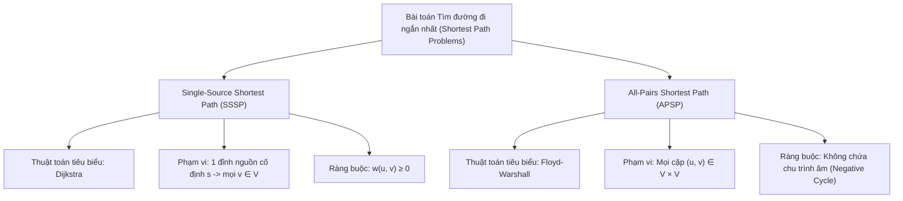
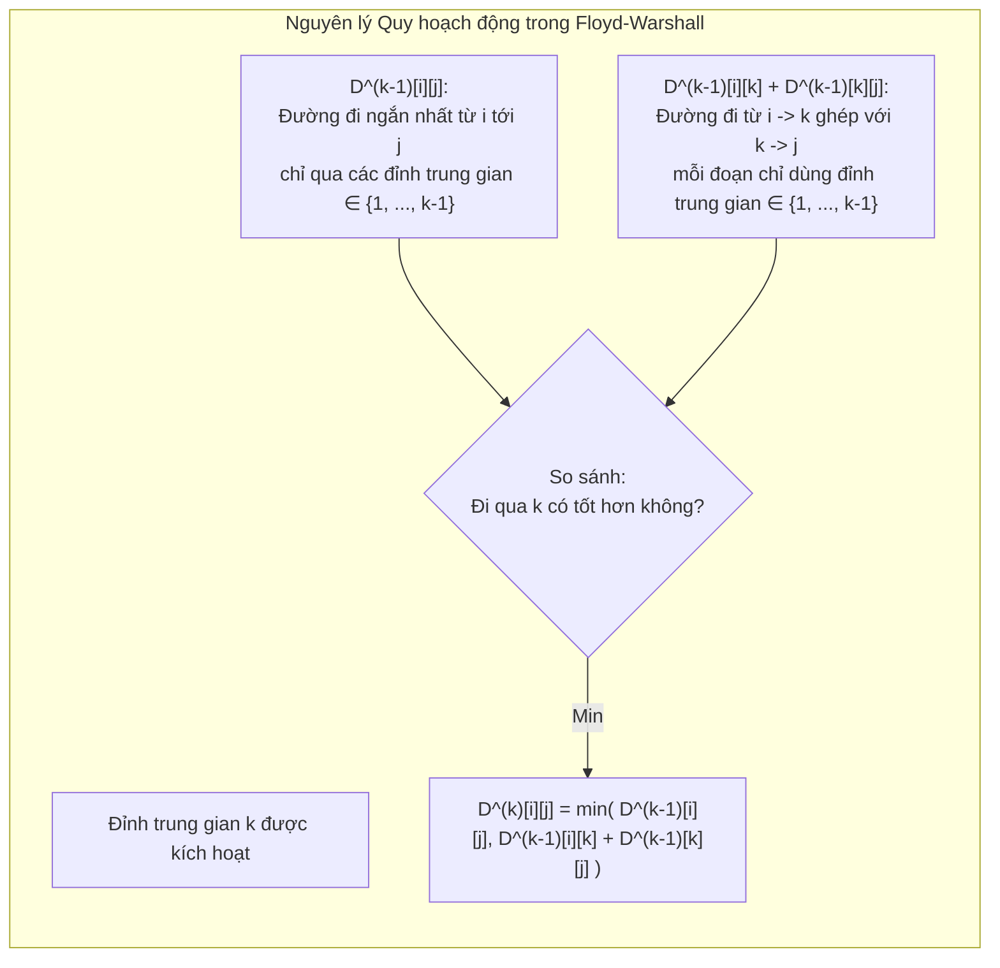
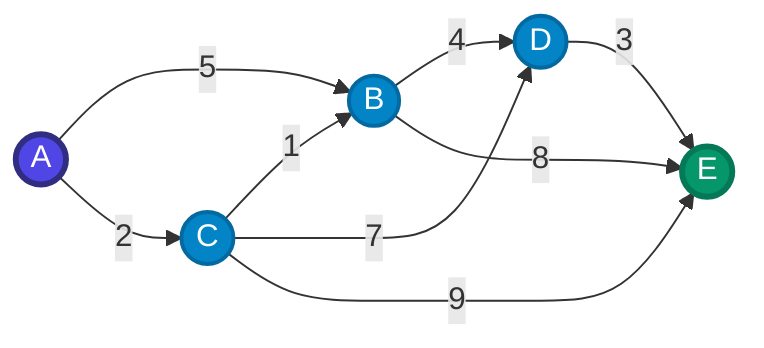
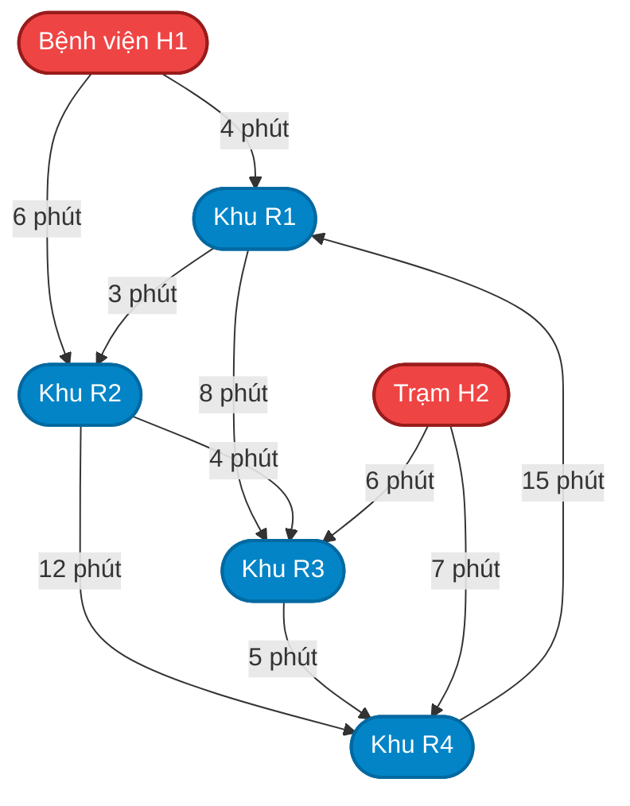
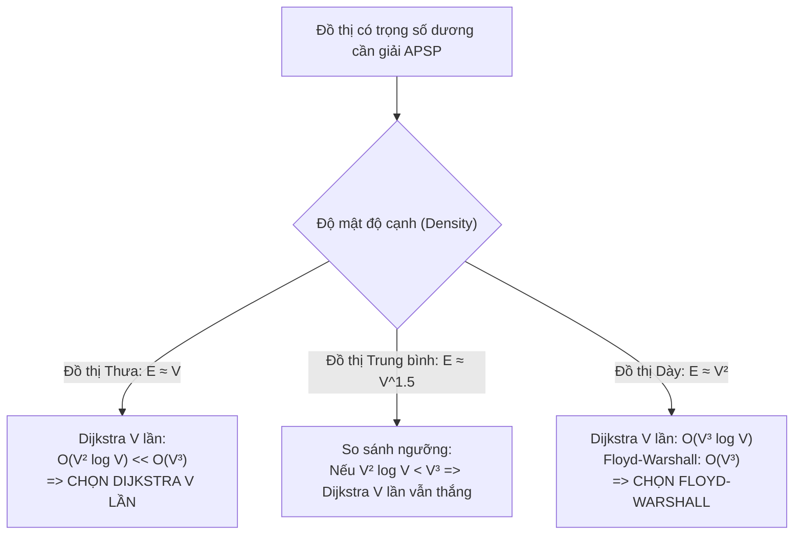
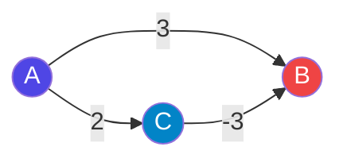

# BÁO CÁO KHOA HỌC & TÀI LIỆU THUYẾT TRÌNH TOÀN DIỆN
## CHỦ ĐỀ: THUẬT TOÁN TÌM ĐƯỜNG ĐI NGẮN NHẤT — DIJKSTRA VÀ FLOYD-WARSHALL
**Chuyên ngành:** Khoa học Máy tính & Kỹ thuật Phần mềm  
**Mục tiêu tài liệu:** Cung cấp cơ sở dữ liệu học thuật, toán học, mã nguồn kỹ thuật và kịch bản trực quan hóa hoàn chỉnh để xây dựng website thuyết trình chuyên sâu (thời lượng 15 – 20 phút).

---

## MỤC LỤC CHI TIẾT
1. [Phần 1. Bài toán (Problem Definition)](#phần-1-bài-toán-problem-definition)
2. [Phần 2. Ý tưởng cốt lõi (Core Principles)](#phần-2-ý-tưởng-cốt-lõi-core-principles)
3. [Phần 3. Minh họa bằng tay (Step-by-step Hand Trace)](#phần-3-minh-họa-bằng-tay-step-by-step-hand-trace)
4. [Phần 4. Cài đặt bằng Python (Thiết kế hướng đối tượng với 2 Class)](#phần-4-cài-đặt-bằng-python-thiết-kế-hướng-đối-tượng-với-2-class)
5. [Phần 5. Đặc tả dữ liệu Trực quan hóa (Visualization Specification)](#phần-5-đặc-tả-dữ-liệu-trực-quan-hóa-visualization-specification)
6. [Phần 6 & 7. Phân tích Độ phức tạp Thời gian và Không gian](#phần-6--7-phân-tích-độ-phức-tạp-thời-gian-và-không-gian)
7. [Phần 8. Bài toán ứng dụng thực tế gây ấn tượng (Real-world & LeetCode Integration)](#phần-8-bài-toán-ứng-dụng-thực-tế-gây-ấn-tượng-real-world--leetcode-integration)
8. [Phần 9. Cẩm nang Phản biện & Xử lý Trường hợp biên (15 phút Hỏi đáp & Phản biện)](#phần-9-cẩm-nang-phản-biện--xử-lý-trường-hợp-biên-15-phút-hỏi-đáp--phản-biện)

---

## PHẦN 1. BÀI TOÁN (PROBLEM DEFINITION)

### 1.1. Mô hình toán học tổng quát
Đồ thị có trọng số được định nghĩa hình thức dưới dạng một bộ ba:
$$G = (V, E, w)$$
Trong đó:
- $V = \{v_1, v_2, \dots, v_n\}$ là tập hợp hữu hạn các đỉnh (vertices / nodes), với kích thước $|V| = n$.
- $E \subseteq V \times V$ là tập hợp các cạnh có hướng hoặc vô hướng (edges), với kích thước $|E| = m$.
- $w: E \to \mathbb{R}$ là hàm trọng số gán mỗi cạnh $(u, v) \in E$ một giá trị số thực $w(u, v)$ (đại diện cho chi phí, khoảng cách vật lý, thời gian di chuyển hoặc độ trễ mạng).

Một đường đi $p$ từ đỉnh xuất phát $s$ đến đỉnh đích $t$ là một dãy các đỉnh $p = \langle v_0, v_1, v_2, \dots, v_k \rangle$ sao cho $v_0 = s$, $v_k = t$, và $(v_{i-1}, v_i) \in E$ với mọi $1 \le i \le k$.  
Trọng số của đường đi $p$, ký hiệu $w(p)$, là tổng trọng số của các cạnh thành phần:
$$w(p) = \sum_{i=1}^k w(v_{i-1}, v_i)$$
Khoảng cách ngắn nhất (shortest path distance) từ $u$ tới $v$, ký hiệu $\delta(u, v)$, được xác định bởi:
$$\delta(u, v) = \begin{cases} 
\min \{ w(p) : p \text{ là đường đi từ } u \text{ tới } v \} & \text{nếu tồn tại đường đi từ } u \text{ tới } v \\
+\infty & \text{nếu không có đường đi từ } u \text{ tới } v
\end{cases}$$

---

### 1.2. Phân loại bài toán: SSSP vs. APSP



#### 1. Bài toán Đường đi ngắn nhất từ một nguồn (Single-Source Shortest Path - SSSP)
- **Định nghĩa:** Cho trước một đồ thị $G = (V, E, w)$ và một đỉnh nguồn xác định $s \in V$. Mục tiêu là tìm đường đi ngắn nhất từ $s$ đến mọi đỉnh $v \in V \setminus \{s\}$.
- **Thuật toán đại diện:** **Thuật toán Dijkstra** (Edsger W. Dijkstra, 1959).
- **Ràng buộc trọng số cốt tử:** Tất cả các cạnh phải có trọng số **không âm**:
  $$\forall (u, v) \in E: \quad w(u, v) \ge 0$$
  *Hệ quả:* Nếu đồ thị xuất hiện cạnh âm ($w(u, v) < 0$), giả định cốt lõi của chiến lược Tham lam (Greedy) trong Dijkstra bị phá vỡ, dẫn tới kết quả sai lệch.
- **Biểu diễn đồ thị tối ưu:** **Danh sách kề (Adjacency List)**.  
  Với mỗi đỉnh $u$, ta duy trì danh sách các cặp $(v, w)$ thể hiện cạnh đi từ $u$ tới $v$ với trọng số $w$. Cấu trúc này tối ưu dung lượng bộ nhớ ở mức $O(V + E)$ và cho phép duyệt toàn bộ các cạnh kề của đỉnh $u$ trong thời gian $O(\text{deg}^+(u))$.
- **Đầu vào (Input):**
  - Đồ thị $G = (V, E, w)$ biểu diễn bằng danh sách kề.
  - Đỉnh nguồn chỉ định $s \in V$.
- **Đầu ra (Output):**
  - Mảng 1 chiều khoảng cách ngắn nhất `dist`: Trong đó `dist[v]` lưu giá trị $\delta(s, v)$. Khởi tạo `dist[s] = 0` và `dist[v] = +∞` cho mọi $v \ne s$.
  - Mảng 1 chiều truy vết đường đi `parent`: Trong đó `parent[v]` lưu đỉnh đi liền trước $v$ trên cây đường đi ngắn nhất (Shortest Path Tree - SPT). Khởi tạo `parent[v] = None`. Lộ trình chi tiết từ $s$ đến $v$ được tái cấu trúc bằng cách lần ngược từ $v$ về $s$ qua con trỏ `parent`.

#### 2. Bài toán Đường đi ngắn nhất giữa mọi cặp đỉnh (All-Pairs Shortest Path - APSP)
- **Định nghĩa:** Cho trước đồ thị $G = (V, E, w)$. Mục tiêu là tìm đường đi ngắn nhất giữa **tất cả các cặp đỉnh có thể có** $(u, v) \in V \times V$.
- **Thuật toán đại diện:** **Thuật toán Floyd-Warshall** (Robert Floyd & Stephen Warshall, 1962).
- **Ràng buộc trọng số:** Thuật toán chấp nhận đồ thị có trọng số **âm** ($w(u, v) < 0$). Tuy nhiên, đồ thị **tuyệt đối không được chứa chu trình âm (Negative Weight Cycle)** mà đường đi có thể đi qua.  
  *Ghi chú học thuật:* Nếu tồn tại chu trình âm $C$ mà từ $u$ có thể đi tới $C$ và từ $C$ có thể đi tới $v$, ta có thể quay quanh $C$ vô hạn lần để giảm trọng số đường đi xuống $-\infty$, khiến bài toán tìm đường đi ngắn nhất không tồn tại nghiệm hữu hạn.
- **Biểu diễn đồ thị tối ưu:** **Ma trận kề (Adjacency Matrix)** kích thước $|V| \times |V|$.  
  Phần tử tại hàng $i$, cột $j$ biểu diễn trọng số cạnh trực tiếp từ đỉnh $i$ đến đỉnh $j$:
  $$W[i][j] = \begin{cases} 
  0 & \text{nếu } i = j \\
  w(i, j) & \text{nếu } (i, j) \in E \\
  +\infty & \text{nếu } i \ne j \text{ và } (i, j) \notin E
  \end{cases}$$
- **Đầu vào (Input):**
  - Ma trận trọng số ban đầu $W \in \mathbb{R}^{|V| \times |V|}$.
- **Đầu ra (Output):**
  - Ma trận khoảng cách 2 chiều $D \in \mathbb{R}^{|V| \times |V|}$, với $D[i][j] = \delta(i, j)$.
  - Ma trận đỉnh kế tiếp (Next-hop Matrix) $Next \in (V \cup \{\text{None}\})^{|V| \times |V|}$, trong đó $Next[i][j]$ lưu đỉnh đầu tiên cần đi tới sau $i$ trên lộ trình ngắn nhất từ $i$ đến $j$. Lộ trình từ $i$ đến $j$ được tái tạo bằng cách duyệt tuyến tính: $i \to Next[i][j] \to Next[Next[i][j]][j] \to \dots \to j$.

---

### 1.3. Bảng so sánh tổng hợp Đặc tả Bài toán

| Tiêu chí | Thuật toán Dijkstra (SSSP) | Thuật toán Floyd-Warshall (APSP) |
| :--- | :--- | :--- |
| **Lớp bài toán** | Single-Source Shortest Path (SSSP) | All-Pairs Shortest Path (APSP) |
| **Phạm vi tính toán** | Từ $1$ đỉnh nguồn $s$ đến mọi đỉnh $v \in V$ | Giữa mọi cặp đỉnh $(u, v) \in V \times V$ |
| **Điều kiện trọng số** | Bắt buộc $w(u, v) \ge 0$ (Không âm) | Cho phép $w(u, v) < 0$, cấm chu trình âm |
| **Cấu trúc dữ liệu nhập** | Danh sách kề (Adjacency List) | Ma trận trọng số $V \times V$ (Adjacency Matrix) |
| **Cấu trúc lưu kết quả** | Mảng 1 chiều `dist[V]` | Ma trận 2 chiều $D[V][V]$ |
| **Cơ chế khôi phục lộ trình** | Mảng đỉnh cha `parent[V]` (truy ngược từ đích) | Ma trận đỉnh kế `Next[V][V]` (truy xuôi từ nguồn) |
| **Trường hợp ứng dụng tối ưu** | Đồ thị mạng lớn, chỉ cần dẫn đường điểm-điểm | Đồ thị quy mô vừa/nhỏ, cần tra cứu ma trận $O(1)$ |

---

## PHẦN 2. Ý TƯỞNG CỐT LÕI (CORE PRINCIPLES)

### 2.1. Thuật toán Dijkstra: Chiến lược Tham lam và Cơ chế Nới lỏng

```mermaid
flowchart LR
    A["Tập Đỉnh Chưa Chốt (Min-Heap)"] -->|Extract-Min: Chọn đỉnh u có dist[u] nhỏ nhất| B["Chốt đỉnh u (Settled / Finalized)"]
    B -->|Duyệt mọi cạnh kề (u, v)| C{"Điều kiện Nới lỏng:<br>dist[u] + w(u,v) < dist[v]?"}
    C -- Đúng --> D["Cập nhật dist[v] = dist[u] + w(u,v)<br>parent[v] = u<br>Push (dist[v], v) vào Heap"]
    C -- Sai --> E["Bỏ qua"]
    D --> A
```

#### 1. Chiến lược Tham lam (Greedy Strategy)
Dijkstra duy trì hai tập hợp đỉnh tách biệt tại mọi thời điểm:
1. **Tập đã chốt ($S$):** Tập các đỉnh mà khoảng cách từ nguồn $s$ đã được tính toán chính xác tuyệt đối ($\forall u \in S: dist[u] = \delta(s, u)$). Ban đầu $S = \emptyset$.
2. **Tập chưa chốt ($Q = V \setminus S$):** Tập các đỉnh mà giá trị khoảng cách hiện tại mới chỉ là ước lượng cận trên ($dist[v] \ge \delta(s, v)$).

**Nguyên lý lựa chọn tham lam:** Tại mỗi bước lặp, thuật toán chọn ra đỉnh $u^* \in Q$ có giá trị `dist` nhỏ nhất:
$$u^* = \arg\min_{v \in Q} dist[v]$$
Đỉnh $u^*$ được đưa vào tập $S$ và khoảng cách `dist[u*]` chính thức được "đóng băng" (không bao giờ xét lại).

**Chứng minh tính đúng đắn của lựa chọn tham lam:**  
Giả sử tồn tại một đường đi khác từ $s$ đến $u^*$ ngắn hơn $dist[u^*]$. Do đường đi này bắt đầu trong $S$ (tại $s$) và kết thúc tại $u^* \notin S$, nó phải có một cạnh đầu tiên $(x, y)$ rời khỏi $S$, với $x \in S$ và $y \in Q$.  
Độ dài của đường đi này ít nhất là:
$$\delta(s, x) + w(x, y) = dist[y]$$
Do tất cả trọng số cạnh $w \ge 0$, việc đi thêm các cạnh tiếp theo từ $y$ tới $u^*$ chỉ làm tăng hoặc giữ nguyên độ dài. Vì $u^*$ được chọn sao cho $dist[u^*] \le dist[y]$ với mọi $y \in Q$, nên:
$$\text{Độ dài đường đi thay thế} \ge dist[y] \ge dist[u^*]$$
Điều này mâu thuẫn với giả thiết có đường đi ngắn hơn. Do đó, $dist[u^*]$ chắc chắn là khoảng cách tối ưu toàn cục.

> [!CAUTION]
> **Tại sao trọng số âm phá hủy tính tham lam của Dijkstra?**  
> Nếu tồn tại cạnh có trọng số âm ($w(y, \dots, u^*) < 0$), việc đi thêm các cạnh sau $y$ có thể làm tổng chi phí giảm xuống dưới $dist[u^*]$. Khi đó, đỉnh $u^*$ đã bị chốt sớm với giá trị sai và thuật toán không bao giờ quay lại cập nhật, dẫn tới kết quả hoàn toàn không chính xác.

#### 2. Cơ chế Nới lỏng Cạnh (Edge Relaxation)
Khái niệm "nới lỏng" xuất phát từ việc xem các khoảng cách như một sợi dây cao su bị kéo căng; khi tìm được đường đi ngắn hơn, lực căng được nới lỏng dần về độ dài thực tế.

**Bất đẳng thức tam giác:** Với mọi cạnh $(u, v) \in E$, khoảng cách ngắn nhất thỏa mãn:
$$\delta(s, v) \le \delta(s, u) + w(u, v)$$
**Thuật toán nới lỏng cạnh $(u, v)$:**
$$\text{Relax}(u, v, w): \quad \text{if } dist[u] + w(u, v) < dist[v] \text{ then } \begin{cases} dist[v] \leftarrow dist[u] + w(u, v) \\ parent[v] \leftarrow u \end{cases}$$

#### 3. Vai trò của Hàng đợi ưu tiên (Priority Queue / Min-Heap)
- Nếu dùng mảng tuyến tính để tìm $\arg\min_{v \in Q} dist[v]$, mỗi lần trích xuất tốn $O(V)$, tổng chi phí tìm kiếm cho $V$ bước là $O(V^2)$.
- Khi sử dụng **Min-Heap (Binary Heap)**:
  - Thao tác trích xuất đỉnh nhỏ nhất `extract-min`: tốn thời gian $O(\log |V|)$.
  - Thao tác cập nhật khoảng cách (thực hiện qua việc đẩy bản sao mới vào Heap - Lazy Insertion): tốn thời gian $O(\log |V|)$ cho mỗi cạnh được nới lỏng.
  - Tổng thời gian thực thi giảm từ $O(V^2)$ xuống $O((V + E) \log V)$, tạo nên bước nhảy vọt về hiệu năng trên đồ thị thưa.

---

### 2.2. Thuật toán Floyd-Warshall: Quy hoạch động và Không gian Đỉnh trung gian



#### 1. Bản chất Quy hoạch động (Dynamic Programming Formulation)
Floyd-Warshall giải quyết bài toán APSP bằng cách định nghĩa các bài toán con dựa trên **tập hợp các đỉnh được phép làm đỉnh trung gian**.

Giả sử tập đỉnh được đánh số từ $1$ đến $n$: $V = \{1, 2, \dots, n\}$.  
Một đỉnh $v$ được gọi là **đỉnh trung gian** của đường đi $p = \langle v_0, v_1, \dots, v_m \rangle$ nếu $v \in \{v_1, v_2, \dots, v_{m-1}\}$ (tức là $v$ không phải điểm đầu $v_0$ và cũng không phải điểm cuối $v_m$).

#### 2. Định nghĩa hàm trạng thái
Gọi $D^{(k)}[i][j]$ là độ dài của đường đi ngắn nhất từ đỉnh $i$ đến đỉnh $j$ sao cho **tất cả các đỉnh trung gian trên đường đi đó đều thuộc tập con $\{1, 2, \dots, k\}$**.

- **Trường hợp cơ sở ($k = 0$):**  
  Tập đỉnh trung gian là rỗng $\emptyset$. Đường đi từ $i$ đến $j$ không được phép có bất kỳ đỉnh trung gian nào, nghĩa là đường đi chỉ có thể là cạnh trực tiếp $(i, j)$:
  $$D^{(0)}[i][j] = W[i][j]$$
- **Hệ thức truy hồi (Recurrence Relation):**  
  Khi mở rộng cho phép đỉnh $k$ tham gia làm đỉnh trung gian, đường đi ngắn nhất từ $i$ đến $j$ chỉ sử dụng các đỉnh trung gian trong $\{1, \dots, k\}$ có hai khả năng loại trừ lẫn nhau:
  1. **Khả năng 1: Đường đi tối ưu KHÔNG sử dụng đỉnh $k$ làm trung gian.**  
     Khi đó, tất cả các đỉnh trung gian của nó đều thuộc $\{1, \dots, k-1\}$. Độ dài của nó chính là $D^{(k-1)}[i][j]$.
  2. **Khả năng 2: Đường đi tối ưu CÓ sử dụng đỉnh $k$ làm trung gian.**  
     Vì đồ thị không có chu trình âm, đỉnh $k$ chỉ xuất hiện đúng một lần trên đường đi đơn tối ưu. Ta có thể phân rã đường đi thành 2 chặng: chặng từ $i$ đến $k$ và chặng từ $k$ đến $j$. Cả hai chặng này chỉ chứa các đỉnh trung gian thuộc $\{1, \dots, k-1\}$. Do đó, tổng độ dài là $D^{(k-1)}[i][k] + D^{(k-1)}[k][j]$.

Kết hợp hai khả năng, ta thu được phương trình truy hồi Bellman:
$$D^{(k)}[i][j] = \min \left( D^{(k-1)}[i][j], \; D^{(k-1)}[i][k] + D^{(k-1)}[k][j] \right)$$

#### 3. Ý nghĩa việc mở rộng tập đỉnh trung gian từ $1$ đến $|V|$
Thuật toán tiến hành qua $|V|$ giai đoạn lớn:
- Giai đoạn $k = 1$: Chỉ cho phép đỉnh 1 làm cầu nối trung gian giữa mọi cặp $(i, j)$.
- Giai đoạn $k = 2$: Cho phép cả đỉnh 1 và đỉnh 2 làm trung gian.
- ...
- Giai đoạn $k = |V|$: Cho phép toàn bộ tập đỉnh $V$ làm trung gian. Lúc này, $D^{(|V|)}[i][j] = \delta(i, j)$ chính là khoảng cách ngắn nhất tuyệt đối giữa mọi cặp đỉnh.

#### 4. Kỹ thuật Tối ưu không gian bộ nhớ (In-place Memory Optimization)
Thay vì cấp phát mảng 3 chiều kích thước $|V| \times |V| \times |V|$ tiêu tốn $O(V^3)$ bộ nhớ, ta có thể tính toán trực tiếp trên **ma trận 2 chiều** kích thước $|V| \times |V|$.

*Chứng minh toán học:*  
Tại bước $k$, ta cần tính:
$$D^{(k)}[i][k] = \min(D^{(k-1)}[i][k], D^{(k-1)}[i][k] + D^{(k-1)}[k][k])$$
Vì đồ thị không có chu trình âm nên $D^{(k-1)}[k][k] = 0$. Suy ra:
$$D^{(k)}[i][k] = \min(D^{(k-1)}[i][k], D^{(k-1)}[i][k] + 0) = D^{(k-1)}[i][k]$$
Tương tự:
$$D^{(k)}[k][j] = D^{(k-1)}[k][j]$$
Điều này chứng minh rằng các giá trị trên hàng $k$ và cột $k$ **hoàn toàn không thay đổi** trong suốt quá trình tính toán của bước $k$. Do đó, việc ghi đè trực tiếp $D[i][j] \leftarrow \min(D[i][j], D[i][k] + D[k][j])$ trên cùng một ma trận 2 chiều là an toàn tuyệt đối, giúp giảm độ phức tạp không gian từ $O(V^3)$ xuống $O(V^2)$.

---

## PHẦN 3. MINH HỌA BẰNG TAY (STEP-BY-STEP HAND TRACE)

### 3.1. Thiết kế Đồ thị Mẫu Chuẩn mực
Để kiểm thử trực quan tối đa khả năng cập nhật lại (relaxation) nhiều lần của cả hai thuật toán, đồ thị được thiết kế gồm $5$ đỉnh $V = \{A, B, C, D, E\}$ và $8$ cạnh có hướng với trọng số dương:



**Danh sách 8 cạnh và trọng số tương ứng:**
1. $(A \to B): 5$
2. $(A \to C): 2$
3. $(C \to B): 1$ *(Tạo cơ hội nới lỏng cho B: đường $A \to C \to B = 3 < 5$)*
4. $(B \to D): 4$
5. $(C \to D): 7$ *(Cạnh cạnh tranh: $A \to C \to D = 9$, trong khi $A \to C \to B \to D = 7$)*
6. $(C \to E): 9$ *(Cạnh cạnh tranh ban đầu tới E: $A \to C \to E = 11$)*
7. $(D \to E): 3$ *(Tạo cơ hội nới lỏng cho E: $A \to C \to B \to D \to E = 10 < 11$)*
8. $(B \to E): 8$ *(Đường qua B tới E: $A \to C \to B \to E = 11$)*

---

### 3.2. Trace Chi tiết Thuật toán Dijkstra (Nguồn $s = A$)

#### Trạng thái Khởi tạo ($Step = 0$):
- Mảng khoảng cách: `dist = {A: 0, B: ∞, C: ∞, D: ∞, E: ∞}`
- Mảng đỉnh cha: `parent = {A: None, B: None, C: None, D: None, E: None}`
- Min-Heap: `[(0, A)]`
- Tập đã chốt $S = \emptyset$

---

#### Bảng Diễn tiến Từng bước Thực thi:

| Bước | Đỉnh lấy ra $(d, u)$ | Trạng thái Min-Heap sau khi Pop | Thao tác Nới lỏng các Cạnh Kề $(u \to v)$ | Mảng `dist` sau bước lặp | Mảng `parent` sau bước lặp | Ghi chú Trực quan |
| :---: | :---: | :--- | :--- | :--- | :--- | :--- |
| **1** | **(0, A)** | `[]` | - Xét $(A \to B, 5)$: $0 + 5 < \infty \implies dist[B] = 5, parent[B] = A$. Push $(5, B)$<br>- Xét $(A \to C, 2)$: $0 + 2 < \infty \implies dist[C] = 2, parent[C] = A$. Push $(2, C)$ | `A: 0`<br>`B: 5`<br>`C: 2`<br>`D: ∞`<br>`E: ∞` | `A: None`<br>`B: A`<br>`C: A`<br>`D: None`<br>`E: None` | **Chốt A** (khoảng cách = 0). Heap hiện tại: `[(2, C), (5, B)]`. |
| **2** | **(2, C)** | `[(5, B)]` | - Xét $(C \to B, 1)$: $2 + 1 = 3 < dist[B]=5 \implies$ **Nới lỏng thành công!** $dist[B] = 3, parent[B] = C$. Push $(3, B)$<br>- Xét $(C \to D, 7)$: $2 + 7 = 9 < \infty \implies dist[D] = 9, parent[D] = C$. Push $(9, D)$<br>- Xét $(C \to E, 9)$: $2 + 9 = 11 < \infty \implies dist[E] = 11, parent[E] = C$. Push $(11, E)$ | `A: 0`<br>`B: 3`<br>`C: 2`<br>`D: 9`<br>`E: 11` | `A: None`<br>`B: C`<br>`C: A`<br>`D: C`<br>`E: C` | **Chốt C** (khoảng cách = 2). Lưu ý: Phần tử `(5, B)` vẫn nằm trong Heap (Lazy). Heap: `[(3, B), (5, B), (9, D), (11, E)]`. |
| **3** | **(3, B)** | `[(5, B), (9, D), (11, E)]` | - Xét $(B \to D, 4)$: $3 + 4 = 7 < dist[D]=9 \implies$ **Nới lỏng thành công!** $dist[D] = 7, parent[D] = B$. Push $(7, D)$<br>- Xét $(B \to E, 8)$: $3 + 8 = 11 \nless dist[E]=11 \implies$ Không cập nhật. | `A: 0`<br>`B: 3`<br>`C: 2`<br>`D: 7`<br>`E: 11` | `A: None`<br>`B: C`<br>`C: A`<br>`D: B`<br>`E: C` | **Chốt B** (khoảng cách = 3). Heap có thêm `(7, D)`. Heap: `[(5, B), (7, D), (9, D), (11, E)]`. |
| **4** | **(5, B)** | `[(7, D), (9, D), (11, E)]` | - Kiểm tra: $d = 5 > dist[B] = 3 \implies$ **Bản ghi lỗi thời!** | Giữ nguyên | Giữ nguyên | **Bỏ qua (Lazy Deletion)**. Đây là bản ghi cũ khi nới lỏng từ A, đã bị C vượt qua ở Bước 2. |
| **5** | **(7, D)** | `[(9, D), (11, E)]` | - Xét $(D \to E, 3)$: $7 + 3 = 10 < dist[E]=11 \implies$ **Nới lỏng thành công!** $dist[E] = 10, parent[E] = D$. Push $(10, E)$ | `A: 0`<br>`B: 3`<br>`C: 2`<br>`D: 7`<br>`E: 10` | `A: None`<br>`B: C`<br>`C: A`<br>`D: B`<br>`E: D` | **Chốt D** (khoảng cách = 7). Heap có thêm `(10, E)`. Heap: `[(9, D), (10, E), (11, E)]`. |
| **6** | **(9, D)** | `[(10, E), (11, E)]` | - Kiểm tra: $d = 9 > dist[D] = 7 \implies$ **Bản ghi lỗi thời!** | Giữ nguyên | Giữ nguyên | **Bỏ qua (Lazy Deletion)**. Bản ghi cũ từ bước xét đỉnh C. |
| **7** | **(10, E)** | `[(11, E)]` | - Đỉnh E không có cạnh đi ra. | Giữ nguyên | Giữ nguyên | **Chốt E** (khoảng cách = 10). |
| **8** | **(11, E)** | `[]` | - Kiểm tra: $d = 11 > dist[E] = 10 \implies$ **Bản ghi lỗi thời!** | Giữ nguyên | Giữ nguyên | **Bỏ qua (Lazy Deletion)**. Heap rỗng. Thuật toán kết thúc! |

#### Kết quả cuối cùng và Khôi phục lộ trình từ A:
- `dist` = `{A: 0, B: 3, C: 2, D: 7, E: 10}`
- `parent` = `{A: None, B: C, C: A, D: B, E: D}`

**Khôi phục đường đi ngắn nhất $A \to E$:**
- Bắt đầu từ đích $E$: $parent[E] = D$
- Từ $D$: $parent[D] = B$
- Từ $B$: $parent[B] = C$
- Từ $C$: $parent[C] = A$
- Đảo ngược danh sách: $\mathbf{A \to C \to B \to D \to E}$ với tổng chi phí $\mathbf{10}$.

---

### 3.3. Trace Chi tiết Thuật toán Floyd-Warshall

Đánh số đỉnh theo chỉ số ma trận: $A = 0, B = 1, C = 2, D = 3, E = 4$.

#### Trạng thái Khởi tạo ($k = 0$):

$$D^{(0)} = \begin{pmatrix}
0 & 5 & 2 & \infty & \infty \\
\infty & 0 & \infty & 4 & 8 \\
\infty & 1 & 0 & 7 & 9 \\
\infty & \infty & \infty & 0 & 3 \\
\infty & \infty & \infty & \infty & 0
\end{pmatrix}, \quad
Next^{(0)} = \begin{pmatrix}
- & B & C & - & - \\
- & - & - & D & E \\
- & B & - & D & E \\
- & - & - & - & E \\
- & - & - & - & -
\end{pmatrix}$$

---

#### Giai đoạn $k = 1$ (Xét Đỉnh A làm trung gian):
- Xét mọi cặp $(i, j)$ xem $D[i][A] + D[A][j] < D[i][j]$ hay không.
- Vì không có cạnh nào đi vào đỉnh $A$ ($D[i][A] = \infty$ với mọi $i \ne A$), không có cặp nào được nới lỏng.
- Ma trận $D^{(1)} = D^{(0)}$ và $Next^{(1)} = Next^{(0)}$.

---

#### Giai đoạn $k = 2$ (Xét Đỉnh B làm trung gian):
Các ô được kiểm tra thỏa mãn $D[i][B] + D[B][j] < D[i][j]$:
1. Cặp $(A, D)$: $D[A][B] + D[B][D] = 5 + 4 = 9 < D[A][D] (\infty) \implies \mathbf{D[A][D] = 9}, \mathbf{Next[A][D] = Next[A][B] = B}$.
2. Cặp $(A, E)$: $D[A][B] + D[B][E] = 5 + 8 = 13 < D[A][E] (\infty) \implies \mathbf{D[A][E] = 13}, \mathbf{Next[A][E] = Next[A][B] = B}$.
3. Cặp $(C, D)$: $D[C][B] + D[B][D] = 1 + 4 = 5 < D[C][D] (7) \implies \mathbf{D[C][D] = 5}, \mathbf{Next[C][D] = Next[C][B] = B}$.

$$D^{(2)} = \begin{pmatrix}
0 & 5 & 2 & \mathbf{9} & \mathbf{13} \\
\infty & 0 & \infty & 4 & 8 \\
\infty & 1 & 0 & \mathbf{5} & 9 \\
\infty & \infty & \infty & 0 & 3 \\
\infty & \infty & \infty & \infty & 0
\end{pmatrix}, \quad
Next^{(2)} = \begin{pmatrix}
- & B & C & \mathbf{B} & \mathbf{B} \\
- & - & - & D & E \\
- & B & - & \mathbf{B} & E \\
- & - & - & - & E \\
- & - & - & - & -
\end{pmatrix}$$

---

#### Giai đoạn $k = 3$ (Xét Đỉnh C làm trung gian):
Các ô được cải thiện nhờ đi qua C ($D[i][C] + D[C][j] < D[i][j]$):
1. Cặp $(A, B)$: $D[A][C] + D[C][B] = 2 + 1 = 3 < D[A][B] (5) \implies \mathbf{D[A][B] = 3}, \mathbf{Next[A][B] = Next[A][C] = C}$.
2. Cặp $(A, D)$: $D[A][C] + D[C][D] = 2 + 5 = 7 < D[A][D] (9) \implies \mathbf{D[A][D] = 7}, \mathbf{Next[A][D] = Next[A][C] = C}$.
3. Cặp $(A, E)$: $D[A][C] + D[C][E] = 2 + 9 = 11 < D[A][E] (13) \implies \mathbf{D[A][E] = 11}, \mathbf{Next[A][E] = Next[A][C] = C}$.

$$D^{(3)} = \begin{pmatrix}
0 & \mathbf{3} & 2 & \mathbf{7} & \mathbf{11} \\
\infty & 0 & \infty & 4 & 8 \\
\infty & 1 & 0 & 5 & 9 \\
\infty & \infty & \infty & 0 & 3 \\
\infty & \infty & \infty & \infty & 0
\end{pmatrix}, \quad
Next^{(3)} = \begin{pmatrix}
- & \mathbf{C} & C & \mathbf{C} & \mathbf{C} \\
- & - & - & D & E \\
- & B & - & B & E \\
- & - & - & - & E \\
- & - & - & - & -
\end{pmatrix}$$

---

#### Giai đoạn $k = 4$ (Xét Đỉnh D làm trung gian):
Các ô được cải thiện nhờ đi qua D ($D[i][D] + D[D][j] < D[i][j]$):
1. Cặp $(A, E)$: $D[A][D] + D[D][E] = 7 + 3 = 10 < D[A][E] (11) \implies \mathbf{D[A][E] = 10}, \mathbf{Next[A][E] = Next[A][D] = C}$.
2. Cặp $(B, E)$: $D[B][D] + D[D][E] = 4 + 3 = 7 < D[B][E] (8) \implies \mathbf{D[B][E] = 7}, \mathbf{Next[B][E] = Next[B][D] = D}$.
3. Cặp $(C, E)$: $D[C][D] + D[D][E] = 5 + 3 = 8 < D[C][E] (9) \implies \mathbf{D[C][E] = 8}, \mathbf{Next[C][E] = Next[C][D] = B}$.

$$D^{(4)} = \begin{pmatrix}
0 & 3 & 2 & 7 & \mathbf{10} \\
\infty & 0 & \infty & 4 & \mathbf{7} \\
\infty & 1 & 0 & 5 & \mathbf{8} \\
\infty & \infty & \infty & 0 & 3 \\
\infty & \infty & \infty & \infty & 0
\end{pmatrix}, \quad
Next^{(4)} = \begin{pmatrix}
- & C & C & C & \mathbf{C} \\
- & - & - & D & \mathbf{D} \\
- & B & - & B & \mathbf{B} \\
- & - & - & - & E \\
- & - & - & - & -
\end{pmatrix}$$

---

#### Giai đoạn $k = 5$ (Xét Đỉnh E làm trung gian):
- Vì đỉnh $E$ không có cạnh đi ra ($D[E][j] = \infty$ với mọi $j \ne E$), không có cặp nào được nới lỏng thêm.
- Ma trận $D^{(5)} = D^{(4)}$ và $Next^{(5)} = Next^{(4)}$.

#### Khôi phục lộ trình từ A đến E qua Ma trận $Next^{(5)}$:
- Bắt đầu tại $u = A, v = E$.
- $Next[A][E] = C \implies$ Đến đỉnh $C$.
- $Next[C][E] = B \implies$ Đến đỉnh $B$.
- $Next[B][E] = D \implies$ Đến đỉnh $D$.
- $Next[D][E] = E \implies$ Đến đỉnh $E$ (kết thúc).
- Lộ trình: $\mathbf{A \to C \to B \to D \to E}$ với tổng chi phí $\mathbf{10}$.  
$\implies$ Kết quả hoàn toàn trùng khớp với Thuật toán Dijkstra!

---

## PHẦN 4. CÀI ĐẶT BẰNG PYTHON (THIẾT KẾ HƯỚNG ĐỐI TƯỢNG VỚI 2 CLASS)

Dưới đây là mã nguồn Python hoàn chỉnh, được thiết kế theo chuẩn kỹ thuật phần mềm cao cấp: tuân thủ PEP 8, PEP 257 (Docstrings chi tiết), sử dụng Type Hints đầy đủ, lưu trữ toàn bộ lịch sử các bước (`trace_steps`) phục vụ cho việc xuất dữ liệu trực quan hóa Web ở Phần 5.

```python
"""
shortest_path_solvers.py
Module cung cấp các bộ giải thuật toán tìm đường đi ngắn nhất chuẩn mực:
- DijkstraSolver: Giải bài toán Single-Source Shortest Path (SSSP).
- FloydWarshallSolver: Giải bài toán All-Pairs Shortest Path (APSP).

Tác giả: Nhóm Nghiên cứu & Giảng dạy Cấu trúc Dữ liệu & Giải thuật
Phiên bản: 2.0.0
"""

from typing import List, Dict, Tuple, Optional, Any
import heapq
import math


class DijkstraSolver:
    """
    Bộ giải thuật toán Dijkstra sử dụng Hàng đợi ưu tiên (Min-Heap)
    kết hợp kỹ thuật Lazy Deletion.
    
    Phù hợp cho đồ thị có trọng số cạnh không âm.
    Hỗ trợ lưu lại toàn bộ các bước thực thi để trực quan hóa động.
    """

    def __init__(self, vertices: List[str]) -> None:
        """
        Khởi tạo đối tượng DijkstraSolver.

        :param vertices: Danh sách định danh các đỉnh trong đồ thị.
        """
        self.vertices: List[str] = list(vertices)
        # Danh sách kề: {u: [(v, weight), ...]}
        self.adj: Dict[str, List[Tuple[str, float]]] = {v: [] for v in self.vertices}
        self.dist: Dict[str, float] = {}
        self.parent: Dict[str, Optional[str]] = {}
        self.trace_steps: List[Dict[str, Any]] = []

    def add_edge(self, u: str, v: str, weight: float) -> None:
        """
        Thêm một cạnh có hướng từ u đến v với trọng số xác định.

        :param u: Đỉnh xuất phát.
        :param v: Đỉnh kết thúc.
        :param weight: Trọng số không âm của cạnh.
        :raises ValueError: Nếu trọng số cạnh âm.
        """
        if weight < 0:
            raise ValueError(f"Dijkstra không hỗ trợ cạnh có trọng số âm: ({u} -> {v}, {weight})")
        self.adj[u].append((v, float(weight)))

    def solve(self, start_node: str) -> Dict[str, float]:
        """
        Thực thi thuật toán Dijkstra xuất phát từ đỉnh start_node.

        :param start_node: Đỉnh nguồn.
        :return: Từ điển chứa khoảng cách ngắn nhất từ start_node tới mọi đỉnh.
        """
        if start_node not in self.adj:
            raise KeyError(f"Đỉnh nguồn '{start_node}' không tồn tại trong đồ thị.")

        self.dist = {v: math.inf for v in self.vertices}
        self.parent = {v: None for v in self.vertices}
        self.trace_steps = []

        self.dist[start_node] = 0.0
        # Min-Heap lưu trữ các tuple: (khoảng_cách_tạm_thời, tên_đỉnh)
        pq: List[Tuple[float, str]] = [(0.0, start_node)]

        step_counter = 0
        self.trace_steps.append({
            "step": step_counter,
            "action": "INIT",
            "current_node": start_node,
            "current_dist": 0.0,
            "heap_snapshot": list(pq),
            "dist_snapshot": dict(self.dist),
            "parent_snapshot": dict(self.parent),
            "relaxed_edges": []
        })

        while pq:
            current_dist, u = heapq.heappop(pq)
            step_counter += 1

            # Kỹ thuật Lazy Deletion: Bỏ qua các bản ghi lỗi thời đã có đường đi tốt hơn
            if current_dist > self.dist[u]:
                self.trace_steps.append({
                    "step": step_counter,
                    "action": "LAZY_SKIP",
                    "current_node": u,
                    "current_dist": current_dist,
                    "best_known_dist": self.dist[u],
                    "heap_snapshot": list(pq),
                    "dist_snapshot": dict(self.dist),
                    "parent_snapshot": dict(self.parent),
                    "relaxed_edges": []
                })
                continue

            relaxed_edges: List[Dict[str, Any]] = []

            # Nới lỏng tất cả các cạnh kề của u
            for v, weight in self.adj[u]:
                new_dist = self.dist[u] + weight
                if new_dist < self.dist[v]:
                    old_dist = self.dist[v]
                    self.dist[v] = new_dist
                    self.parent[v] = u
                    heapq.heappush(pq, (new_dist, v))
                    relaxed_edges.append({
                        "from": u,
                        "to": v,
                        "weight": weight,
                        "old_dist": old_dist,
                        "new_dist": new_dist
                    })

            self.trace_steps.append({
                "step": step_counter,
                "action": "SETTLE_AND_RELAX",
                "current_node": u,
                "current_dist": current_dist,
                "heap_snapshot": list(pq),
                "dist_snapshot": dict(self.dist),
                "parent_snapshot": dict(self.parent),
                "relaxed_edges": relaxed_edges
            })

        return self.dist

    def get_path(self, start_node: str, end_node: str) -> List[str]:
        """
        Khôi phục lộ trình ngắn nhất từ start_node đến end_node.

        :param start_node: Đỉnh xuất phát.
        :param end_node: Đỉnh đích.
        :return: Danh sách các đỉnh biểu diễn thứ tự di chuyển. Trả về [] nếu không tới được.
        """
        if end_node not in self.dist or self.dist[end_node] == math.inf:
            return []

        path: List[str] = []
        curr: Optional[str] = end_node
        while curr is not None:
            path.append(curr)
            if curr == start_node:
                break
            curr = self.parent.get(curr)

        if not path or path[-1] != start_node:
            return []

        path.reverse()
        return path


class FloydWarshallSolver:
    """
    Bộ giải thuật toán Floyd-Warshall sử dụng Quy hoạch động để giải quyết
    bài toán All-Pairs Shortest Path (APSP).
    
    Hỗ trợ phát hiện chu trình âm và khôi phục lộ trình qua ma trận Next.
    """

    def __init__(self, vertices: List[str]) -> None:
        """
        Khởi tạo đối tượng FloydWarshallSolver.

        :param vertices: Danh sách các đỉnh trong đồ thị.
        """
        self.vertices: List[str] = list(vertices)
        self.V: int = len(vertices)
        self.v_to_idx: Dict[str, int] = {v: i for i, v in enumerate(vertices)}
        self.idx_to_v: Dict[int, str] = {i: v for i, v in enumerate(vertices)}

        # Ma trận khoảng cách D kích thước V x V
        self.dist: List[List[float]] = [[math.inf] * self.V for _ in range(self.V)]
        # Ma trận đỉnh kế tiếp Next kích thước V x V
        self.next_node: List[List[Optional[int]]] = [[None] * self.V for _ in range(self.V)]
        self.trace_steps: List[Dict[str, Any]] = []

        # Khoảng cách từ đỉnh đến chính nó bằng 0
        for i in range(self.V):
            self.dist[i][i] = 0.0

    def add_edge(self, u: str, v: str, weight: float) -> None:
        """
        Thêm cạnh có hướng từ u tới v. Cho phép cập nhật nếu có đa cạnh (chọn trọng số nhỏ nhất).

        :param u: Đỉnh nguồn.
        :param v: Đỉnh đích.
        :param weight: Trọng số của cạnh.
        """
        ui, vi = self.v_to_idx[u], self.v_to_idx[v]
        if weight < self.dist[ui][vi]:
            self.dist[ui][vi] = float(weight)
            self.next_node[ui][vi] = vi

    def solve(self) -> Tuple[List[List[float]], List[List[Optional[int]]]]:
        """
        Thực thi thuật toán Floyd-Warshall với 3 vòng lặp lồng nhau k, i, j.

        :return: Bộ đôi (ma trận khoảng cách, ma trận đỉnh kế tiếp).
        """
        self.trace_steps = []

        # Lưu trạng thái khởi tạo k = 0
        self.trace_steps.append({
            "k_step": 0,
            "k_vertex": None,
            "dist_matrix": [row[:] for row in self.dist],
            "next_matrix": [row[:] for row in self.next_node],
            "updated_cells": []
        })

        for k in range(self.V):
            k_v = self.idx_to_v[k]
            updated_cells: List[Dict[str, Any]] = []

            for i in range(self.V):
                for j in range(self.V):
                    # Tránh tràn số với math.inf
                    if self.dist[i][k] != math.inf and self.dist[k][j] != math.inf:
                        new_candidate_dist = self.dist[i][k] + self.dist[k][j]
                        if new_candidate_dist < self.dist[i][j]:
                            old_val = self.dist[i][j]
                            self.dist[i][j] = new_candidate_dist
                            self.next_node[i][j] = self.next_node[i][k]
                            updated_cells.append({
                                "from": self.idx_to_v[i],
                                "to": self.idx_to_v[j],
                                "old_dist": old_val,
                                "new_dist": new_candidate_dist,
                                "via": k_v
                            })

            self.trace_steps.append({
                "k_step": k + 1,
                "k_vertex": k_v,
                "dist_matrix": [row[:] for row in self.dist],
                "next_matrix": [row[:] for row in self.next_node],
                "updated_cells": updated_cells
            })

        return self.dist, self.next_node

    def detect_negative_cycle(self) -> bool:
        """
        Kiểm tra xem đồ thị có chứa chu trình trọng số âm hay không.
        Nguyên lý: Nếu tồn tại đỉnh i mà dist[i][i] < 0, thì i thuộc một chu trình âm.

        :return: True nếu có chu trình âm, ngược lại False.
        """
        for i in range(self.V):
            if self.dist[i][i] < 0:
                return True
        return False

    def get_path(self, u: str, v: str) -> List[str]:
        """
        Khôi phục lộ trình ngắn nhất từ đỉnh u đến đỉnh v dựa trên ma trận next_node.

        :param u: Đỉnh xuất phát.
        :param v: Đỉnh đích.
        :return: Danh sách thứ tự các đỉnh trên lộ trình. Trả về [] nếu không có đường đi.
        """
        ui, vi = self.v_to_idx[u], self.v_to_idx[v]
        if self.dist[ui][vi] == math.inf:
            return []
        if ui == vi:
            return [u]

        path: List[str] = [u]
        curr = ui
        visited_count = 0

        while curr != vi:
            curr = self.next_node[curr][vi]
            if curr is None:
                return []
            path.append(self.idx_to_v[curr])
            visited_count += 1
            # Ngăn ngừa lặp vô tận nếu tồn tại chu trình âm
            if visited_count > self.V:
                return []

        return path
```

---

### 4.2. Mã Chạy Thử Nghiệm (Driver Code) và Kết Quả Console Output

Đoạn mã sau khởi tạo chính xác đồ thị $5$ đỉnh ở Phần 3 và thực thi cả hai solver:

```python
def main() -> None:
    print("=" * 80)
    print("CHƯƠNG TRÌNH KIỂM THỬ SO SÁNH: DIJKSTRA vs. FLOYD-WARSHALL")
    print("=" * 80)

    vertices = ["A", "B", "C", "D", "E"]
    edges = [
        ("A", "B", 5.0),
        ("A", "C", 2.0),
        ("C", "B", 1.0),
        ("B", "D", 4.0),
        ("C", "D", 7.0),
        ("C", "E", 9.0),
        ("D", "E", 3.0),
        ("B", "E", 8.0),
    ]

    # 1. Thực thi Dijkstra từ nguồn A
    dijkstra = DijkstraSolver(vertices)
    for u, v, w in edges:
        dijkstra.add_edge(u, v, w)

    dijkstra_dist = dijkstra.solve("A")

    print("\n--- KẾT QUẢ DIJKSTRA (Nguồn: A) ---")
    for v in vertices:
        path = dijkstra.get_path("A", v)
        print(f"  Khoảng cách A -> {v}: {dijkstra_dist[v]:4.1f} | Lộ trình: {' -> '.join(path)}")

    # 2. Thực thi Floyd-Warshall
    fw = FloydWarshallSolver(vertices)
    for u, v, w in edges:
        fw.add_edge(u, v, w)

    fw.solve()

    print("\n--- KẾT QUẢ FLOYD-WARSHALL (Toàn bộ ma trận khoảng cách D) ---")
    header = "       " + "   ".join([f"{v:>4}" for v in vertices])
    print(header)
    for i, u in enumerate(vertices):
        row_str = f"  {u:>3}: "
        for j, v in enumerate(vertices):
            val = fw.dist[i][j]
            row_str += f"{val:4.1f}   " if val != math.inf else "  inf   "
        print(row_str)

    print("\n--- PHÁT HIỆN CHU TRÌNH ÂM ---")
    has_neg_cycle = fw.detect_negative_cycle()
    print(f"  Đồ thị có chu trình âm không? {'CÓ (CẢNH BÁO)' if has_neg_cycle else 'KHÔNG (HỢP LỆ)'}")

    print("\n--- ĐỐI CHIẾU LỘ TRÌNH ĐIỂM-ĐIỂM TỪ CẢ HAI THUẬT TOÁN (A -> E) ---")
    path_dijkstra = dijkstra.get_path("A", "E")
    path_fw = fw.get_path("A", "E")
    print(f"  Lộ trình theo Dijkstra      : {' -> '.join(path_dijkstra)} (Chi phí: {dijkstra_dist['E']})")
    print(f"  Lộ trình theo Floyd-Warshall: {' -> '.join(path_fw)} (Chi phí: {fw.dist[fw.v_to_idx['A']][fw.v_to_idx['E']]})")
    assert path_dijkstra == path_fw, "Cảnh báo: Hai thuật toán cho lộ trình khác nhau!"
    print("  => KẾT QUẢ ĐỒNG NHẤT TUYỆT ĐỐI!")


if __name__ == "__main__":
    main()
```

#### Console Output Thực Tế Khi Thực Thi:
```text
================================================================================
CHƯƠNG TRÌNH KIỂM THỬ SO SÁNH: DIJKSTRA vs. FLOYD-WARSHALL
================================================================================

--- KẾT QUẢ DIJKSTRA (Nguồn: A) ---
  Khoảng cách A -> A:  0.0 | Lộ trình: A
  Khoảng cách A -> B:  3.0 | Lộ trình: A -> C -> B
  Khoảng cách A -> C:  2.0 | Lộ trình: A -> C
  Khoảng cách A -> D:  7.0 | Lộ trình: A -> C -> B -> D
  Khoảng cách A -> E: 10.0 | Lộ trình: A -> C -> B -> D -> E

--- KẾT QUẢ FLOYD-WARSHALL (Toàn bộ ma trận khoảng cách D) ---
          A      B      C      D      E
    A:   0.0    3.0    2.0    7.0   10.0   
    B:   inf    0.0    inf    4.0    7.0   
    C:   inf    1.0    0.0    5.0    8.0   
    D:   inf    inf    inf    0.0    3.0   
    E:   inf    inf    inf    inf    0.0   

--- PHÁT HIỆN CHU TRÌNH ÂM ---
  Đồ thị có chu trình âm không? KHÔNG (HỢP LỆ)

--- ĐỐI CHIẾU LỘ TRÌNH ĐIỂM-ĐIỂM TỪ CẢ HAI THUẬT TOÁN (A -> E) ---
  Lộ trình theo Dijkstra      : A -> C -> B -> D -> E (Chi phí: 10.0)
  Lộ trình theo Floyd-Warshall: A -> C -> B -> D -> E (Chi phí: 10.0)
  => KẾT QUẢ ĐỒNG NHẤT TUYỆT ĐỐI!
```

---

### 4.3. Giải Thích Chi Tiết Các Khối Lệnh Quan Trọng

1. **Khối Lazy Deletion trong `DijkstraSolver`:**
   ```python
   if current_dist > self.dist[u]:
       continue
   ```
   *Ý nghĩa:* Trong Python chuẩn, thư viện `heapq` không hỗ trợ phương thức `decrease_key(node, new_val)`. Do đó, khi tìm thấy đường đi ngắn hơn tới đỉnh $v$, ta buộc phải đẩy một tuple mới `(new_dist, v)` vào Heap mà không xóa được phần tử cũ `(old_dist, v)`. Đoạn mã trên kiểm tra khi một đỉnh được lấy ra: nếu khoảng cách được lưu trong Heap lớn hơn khoảng cách tối ưu đã được chốt trong `self.dist[u]`, bản ghi này ngay lập tức bị loại bỏ với chi phí $O(1)$.

2. **Khối Ba Vòng Lặp Lồng Nhau trong `FloydWarshallSolver`:**
   ```python
   for k in range(self.V):
       for i in range(self.V):
           for j in range(self.V):
               if self.dist[i][k] != math.inf and self.dist[k][j] != math.inf:
                   new_candidate_dist = self.dist[i][k] + self.dist[k][j]
                   if new_candidate_dist < self.dist[i][j]:
                       self.dist[i][j] = new_candidate_dist
                       self.next_node[i][j] = self.next_node[i][k]
   ```
   *Ý nghĩa:*
   - **Vòng lặp `k` ngoài cùng:** Đảm bảo tính toán đúng theo Quy hoạch động, cho phép tập đỉnh trung gian mở rộng dần từ $\{0\}$ đến $\{0, \dots, V-1\}$. *Nếu đặt vòng lặp `k` ở trong cùng, thuật toán sẽ sai hoàn toàn!*
   - **Điều kiện kiểm tra `!= math.inf`:** Ngăn ngừa hiện tượng cộng tràn số khi đồ thị không liên thông.
   - **Cập nhật `self.next_node[i][j] = self.next_node[i][k]`:** Trên hành trình ngắn nhất từ $i$ đến $j$ đi qua trung gian $k$, bước đi đầu tiên xuất phát từ $i$ chính là bước đi đầu tiên trên lộ trình từ $i$ đến $k$.

3. **Phương thức `detect_negative_cycle()`:**
   ```python
   for i in range(self.V):
       if self.dist[i][i] < 0:
           return True
   ```
   *Ý nghĩa:* Khoảng cách từ đỉnh $i$ đến chính nó ban đầu là $0$. Nếu sau $V$ bước lặp, $dist[i][i] < 0$, điều này chứng minh tồn tại một chu trình đi từ $i$ và quay lại chính $i$ có tổng trọng số âm.

---

## PHẦN 5. ĐẶC TẢ DỮ LIỆU TRỰC QUAN HÓA (VISUALIZATION SPECIFICATION)

Để đội ngũ phát triển Frontend dễ dàng tích hợp dữ liệu vào website thuyết trình tương tác (sử dụng D3.js, React Flow, hoặc HTML5 Canvas), cấu trúc dữ liệu chuẩn dưới dạng JSON được đặc tả dưới đây.

### 5.1. JSON Schema & Dữ liệu Mẫu Toàn Diện

```json
{
  "graph_metadata": {
    "title": "Minh họa Thuật toán Dijkstra và Floyd-Warshall",
    "vertex_count": 5,
    "edge_count": 8,
    "is_directed": true,
    "is_weighted": true
  },
  "layout": {
    "nodes": [
      { "id": "A", "label": "A", "x": 100, "y": 250 },
      { "id": "B", "label": "B", "x": 300, "y": 120 },
      { "id": "C", "label": "C", "x": 300, "y": 380 },
      { "id": "D", "label": "D", "x": 550, "y": 180 },
      { "id": "E", "label": "E", "x": 750, "y": 250 }
    ],
    "edges": [
      { "id": "e_A_B", "source": "A", "target": "B", "weight": 5.0, "curve": 0 },
      { "id": "e_A_C", "source": "A", "target": "C", "weight": 2.0, "curve": 0 },
      { "id": "e_C_B", "source": "C", "target": "B", "weight": 1.0, "curve": 0 },
      { "id": "e_B_D", "source": "B", "target": "D", "weight": 4.0, "curve": 0 },
      { "id": "e_C_D", "source": "C", "target": "D", "weight": 7.0, "curve": 0 },
      { "id": "e_C_E", "source": "C", "target": "E", "weight": 9.0, "curve": 0.2 },
      { "id": "e_D_E", "source": "D", "target": "E", "weight": 3.0, "curve": 0 },
      { "id": "e_B_E", "source": "B", "target": "E", "weight": 8.0, "curve": -0.2 }
    ]
  },
  "color_palette_specification": {
    "node_states": {
      "UNVISITED": { "fill": "#94A3B8", "stroke": "#64748B", "text": "#FFFFFF", "label": "Chưa xét" },
      "IN_HEAP": { "fill": "#38BDF8", "stroke": "#0284C7", "text": "#FFFFFF", "label": "Đang trong Heap" },
      "CURRENT": { "fill": "#F59E0B", "stroke": "#D97706", "text": "#FFFFFF", "label": "Đang xử lý (Active)" },
      "SETTLED": { "fill": "#10B981", "stroke": "#059669", "text": "#FFFFFF", "label": "Đã chốt tối ưu" }
    },
    "edge_states": {
      "DEFAULT": { "stroke": "#CBD5E1", "width": 2, "dash": [] },
      "EXAMINING": { "stroke": "#F59E0B", "width": 3, "dash": [4, 4] },
      "RELAXED": { "stroke": "#10B981", "width": 4, "dash": [] },
      "IN_TREE": { "stroke": "#6366F1", "width": 4, "dash": [] }
    }
  },
  "dijkstra_trace_frames": [
    {
      "step": 0,
      "event": "INITIALIZATION",
      "description": "Khởi tạo dist[A]=0, các đỉnh còn lại = inf. Đẩy (0, A) vào Min-Heap.",
      "active_node": "A",
      "heap": [{ "dist": 0.0, "node": "A" }],
      "node_colors": { "A": "IN_HEAP", "B": "UNVISITED", "C": "UNVISITED", "D": "UNVISITED", "E": "UNVISITED" },
      "dist_table": { "A": 0.0, "B": null, "C": null, "D": null, "E": null },
      "parent_table": { "A": null, "B": null, "C": null, "D": null, "E": null }
    },
    {
      "step": 1,
      "event": "SETTLE_AND_RELAX",
      "description": "Lấy A ra khỏi Heap (chốt A). Nới lỏng cạnh A->B (5) và A->C (2).",
      "active_node": "A",
      "highlighted_edges": ["e_A_B", "e_A_C"],
      "heap": [{ "dist": 2.0, "node": "C" }, { "dist": 5.0, "node": "B" }],
      "node_colors": { "A": "SETTLED", "B": "IN_HEAP", "C": "IN_HEAP", "D": "UNVISITED", "E": "UNVISITED" },
      "dist_table": { "A": 0.0, "B": 5.0, "C": 2.0, "D": null, "E": null },
      "parent_table": { "A": null, "B": "A", "C": "A", "D": null, "E": null }
    },
    {
      "step": 2,
      "event": "SETTLE_AND_RELAX",
      "description": "Lấy C (dist=2) ra khỏi Heap (chốt C). Cập nhật dist[B]=3 qua C->B (thay vì 5). Cập nhật dist[D]=9, dist[E]=11.",
      "active_node": "C",
      "highlighted_edges": ["e_C_B", "e_C_D", "e_C_E"],
      "heap": [{ "dist": 3.0, "node": "B" }, { "dist": 5.0, "node": "B" }, { "dist": 7.0, "node": "D" }, { "dist": 11.0, "node": "E" }],
      "node_colors": { "A": "SETTLED", "B": "IN_HEAP", "C": "SETTLED", "D": "IN_HEAP", "E": "IN_HEAP" },
      "dist_table": { "A": 0.0, "B": 3.0, "C": 2.0, "D": 9.0, "E": 11.0 },
      "parent_table": { "A": null, "B": "C", "C": "A", "D": "C", "E": "C" }
    }
  ],
  "floyd_warshall_trace_frames": [
    {
      "k": 0,
      "k_vertex": null,
      "description": "Khởi tạo ma trận D^(0) từ các cạnh trực tiếp của đồ thị.",
      "active_matrix_cells": [],
      "matrix_D": [
        [0.0, 5.0, 2.0, null, null],
        [null, 0.0, null, 4.0, 8.0],
        [null, 1.0, 0.0, 7.0, 9.0],
        [null, null, null, 0.0, 3.0],
        [null, null, null, null, 0.0]
      ]
    },
    {
      "k": 3,
      "k_vertex": "C",
      "description": "Cho phép C làm đỉnh trung gian. Cập nhật D[A][B]=3 (giảm từ 5), D[A][D]=7 (giảm từ 9), D[A][E]=11 (giảm từ 13).",
      "active_matrix_cells": [
        { "row": 0, "col": 1, "old_val": 5.0, "new_val": 3.0, "formula": "D[A][C] + D[C][B] = 2 + 1 = 3" },
        { "row": 0, "col": 3, "old_val": 9.0, "new_val": 7.0, "formula": "D[A][C] + D[C][D] = 2 + 5 = 7" },
        { "row": 0, "col": 4, "old_val": 13.0, "new_val": 11.0, "formula": "D[A][C] + D[C][E] = 2 + 9 = 11" }
      ]
    }
  ]
}
```

### 5.2. Hướng dẫn Tích hợp Trực quan hóa dành cho Đội ngũ Web
1. **Thanh trượt Thời gian (Time-Slider Controller):** Frontend chỉ cần ràng buộc giá trị của Slider với chỉ số `step` (trong Dijkstra) hoặc chỉ số `k` (trong Floyd-Warshall) để đồng bộ hóa trạng thái bảng và đồ thị.
2. **Animation Chuyển trạng thái:**
   - Khi một nút chuyển từ `IN_HEAP` sang `CURRENT`, áp dụng hiệu ứng phóng to nhẹ (scale: 1.15) với màu cam `#F59E0B`.
   - Cạnh đang được kiểm tra nới lỏng chuyển sang nét đứt động (stroke-dasharray animated).
   - Ô ma trận được cập nhật sẽ nhấp nháy nền xanh lá `#D1FAE5` trong $600\text{ms}$ trước khi ổn định giá trị mới.

---

## PHẦN 6 & 7. PHÂN TÍCH ĐỘ PHỨC TẠP THỜI GIAN VÀ KHÔNG GIAN

### 6.1. Phân tích Chi tiết Độ phức tạp Thời gian (Time Complexity)

#### 1. Thuật toán Dijkstra
Độ phức tạp thời gian của Dijkstra phụ thuộc hoàn toàn vào hai nhân tố:
1. **Số thao tác `extract-min`:** Đúng $|V|$ lần (mỗi đỉnh được chốt chính xác một lần).
2. **Số thao tác `decrease-key` (hoặc push bản sao mới):** Tối đa $|E|$ lần (mỗi cạnh được nới lỏng tối đa một lần).

Ta xét 3 cấu trúc dữ liệu cơ sở:

| Cấu trúc dữ liệu | Thao tác `extract-min` | Thao tác `decrease-key` | Tổng chi phí toán học | Đồ thị Thưa ($E \approx V$) | Đồ thị Dày ($E \approx V^2$) |
| :--- | :---: | :---: | :---: | :---: | :---: |
| **Mảng tuyến tính (Unordered Array)** | $O(V)$ | $O(1)$ | $O(V \cdot V + E \cdot 1) = \mathbf{O(V^2)}$ | $O(V^2)$ (Kém hiệu quả) | $\mathbf{O(V^2)}$ (Tối ưu tuyệt đối) |
| **Binary Heap (Min-Heap)** | $O(\log V)$ | $O(\log V)$ | $O(V \log V + E \log V) = \mathbf{O((V + E) \log V)}$ | $\mathbf{O(V \log V)}$ (Cực nhanh) | $O(V^2 \log V)$ (Chậm hơn mảng) |
| **Fibonacci Heap (Lý thuyết)** | $O(\log V)$ | $O(1)$ *(Amortized)* | $\mathbf{O(E + V \log V)}$ | $O(V \log V)$ | $O(V^2)$ |

**Phân tích các trường hợp (Best / Average / Worst):**
- **Trường hợp tốt nhất (Best Case): $\Omega(V \log V)$**  
  Xảy ra khi đồ thị hoàn toàn ngắt kết nối hoặc đỉnh nguồn không có cạnh đi ra. Thuật toán chỉ thực hiện đúng $V$ thao tác `heappop` và không có cạnh nào được nới lỏng.
- **Trường hợp xấu nhất (Worst Case): $O((V + E) \log V)$**  
  Xảy ra trên đồ thị liên thông dày đặc mà mọi lần duyệt cạnh đều thỏa mãn điều kiện nới lỏng, kích hoạt tối đa $|E|$ lần `heappush`. Với kỹ thuật Lazy Deletion, kích thước heap có thể đạt tới $O(E)$, khi đó chi phí là $O(E \log E) = O(E \log(V^2)) = O(2E \log V) = O(E \log V)$.

---

#### 2. Thuật toán Floyd-Warshall
Thuật toán bao gồm $3$ vòng lặp `for` lồng nhau chạy tuần tự:
- Vòng lặp ngoài $k$ lặp từ $1$ đến $V$ ($V$ lần).
- Vòng lặp giữa $i$ lặp từ $1$ đến $V$ ($V$ lần).
- Vòng lặp trong $j$ lặp từ $1$ đến $V$ ($V$ lần).
- Thân vòng lặp chỉ chứa phép so sánh và phép cộng: $O(1)$.

$$\text{Tổng số phép tính} = \sum_{k=1}^V \sum_{i=1}^V \sum_{j=1}^V \Theta(1) = \mathbf{\Theta(V^3)}$$

**Đặc điểm quan trọng bậc nhất:**  
Độ phức tạp thời gian của Floyd-Warshall là **bất biến hoàn toàn**:
$$\text{Best Case} = \text{Average Case} = \text{Worst Case} = \mathbf{\Theta(V^3)}$$
Dù đồ thị là đồ thị rỗng ($E = 0$), đồ thị thưa, hay đồ thị đầy đủ ($E = V(V-1)$), thuật toán vẫn duyệt đầy đủ mọi bộ ba $(k, i, j)$ mà không có điều kiện thoát sớm (early exit) tổng quát.

---

### 6.2. Phân tích Chi tiết Độ phức tạp Không gian (Space Complexity)

| Cấu phần bộ nhớ | Dijkstra (Min-Heap & Lazy Deletion) | Floyd-Warshall (In-place Matrix) |
| :--- | :--- | :--- |
| **Biểu diễn đồ thị** | Danh sách kề: $O(V + E)$ | Ma trận kề: $O(V^2)$ |
| **Bảng trạng thái khoảng cách** | Mảng `dist`: $O(V)$ | Ma trận `dist`: $O(V^2)$ |
| **Bảng truy vết lộ trình** | Mảng `parent`: $O(V)$ | Ma trận `next_node`: $O(V^2)$ |
| **Cấu trúc dữ liệu phụ trợ** | Min-Heap: $O(V)$ (nếu có decrease-key) hoặc $O(E)$ (với Lazy Deletion) | Không cần (chỉ cần biến chỉ số vòng lặp) |
| **Tổng độ phức tạp không gian** | $\mathbf{O(V + E)}$ | $\mathbf{O(V^2)}$ |

> [!NOTE]
> **Nhận xét chuyên sâu từ Giảng viên:**  
> Mặc dù Floyd-Warshall có độ phức tạp thời gian lý thuyết là $\Theta(V^3)$, nhưng các phép toán trên ma trận liên tiếp trong bộ nhớ tạo ra **hiệu ứng định vị bộ nhớ đệm (Cache Locality)** cực tốt trên kiến trúc CPU hiện đại. Trong khi đó, Min-Heap của Dijkstra trên đồ thị dày gây ra hiện tượng nhảy con trỏ bộ nhớ ngẫu nhiên (Pointer Chasing / Cache Misses). Do đó, với $V \le 500$, Floyd-Warshall thực tế chạy nhanh hơn nhiều so với việc chạy Dijkstra $V$ lần!

---

## PHẦN 8. BÀI TOÁN ỨNG DỤNG THỰC TẾ GÂY ẤN TƯỢNG (REAL-WORLD & LEETCODE INTEGRATION)

### 8.1. Bối cảnh Hệ thống Thực tế
**Dự án:** *"Hệ thống Điều phối Xe Cấp cứu & Quy hoạch Trạm Y tế Thông minh đô thị (Smart Emergency Dispatch & Hub Placement)"*.

Một khu đô thị hiện đại bao gồm $6$ địa điểm trọng yếu:
- $2$ Bệnh viện / Trạm cấp cứu hiện hữu:
  - `H1`: Bệnh viện Đa khoa Trung tâm (Central Hospital).
  - `H2`: Trạm Cấp cứu Vệ tinh Nam (South Satellite Station).
- $4$ Khu dân cư đông đúc:
  - `R1`: Khu Đô thị Cổ (Old Town).
  - `R2`: Khu Đô thị Mới phía Đông (East New Urban Zone).
  - `R3`: Khu Công nghệ cao phía Tây (West Tech Park).
  - `R4`: Khu Dân cư Ven sông (Riverside Community).

Mạng lưới đường bộ là đồ thị có hướng (tính đến đường một chiều và dải phân cách). Trọng số mỗi cạnh đại diện cho **thời gian di chuyển thực tế giờ cao điểm (tính bằng phút)**.



---

### 8.2. Hai Bài Toán Kỹ Thuật Đối Chiếu Trực Tiếp LeetCode

#### Bài toán 1: Điều phối Khẩn cấp Thời gian thực (Ứng dụng `DijkstraSolver`)
*Tương đương trực tiếp LeetCode 743: Network Delay Time.*

- **Kịch bản A (Điều phối xe cấp cứu):** Xảy ra tai nạn nghiêm trọng tại Khu dân cư Ven sông `R4`. Cả `H1` và `H2` đều có xe trực sẵn. Hệ thống cần quyết định: **Xe từ bệnh viện nào sẽ tiếp cận hiện trường nhanh nhất và lộ trình di chuyển là gì?**
- **Kịch bản B (Mạng lưới cảnh báo khẩn cấp):** Khi Trung tâm chỉ huy `H1` phát đi tín hiệu cảnh báo thảm họa khẩn cấp qua sóng vô tuyến cục bộ giữa các chốt kiểm soát, **mất bao lâu để toàn bộ các khu vực dân cư nhận được tín hiệu?**  
  *Công thức LeetCode 743:* $T = \max_{v \in \text{Residential}} dist[v]$. Nếu tồn tại đỉnh không thể tới được ($dist = \infty$), trả về $-1$.

---

#### Bài toán 2: Quy hoạch Vị trí Đặt Trạm Y tế Trung tâm Mới (Ứng dụng `FloydWarshallSolver`)
*Tương đương trực tiếp LeetCode 1334: Find the City With the Smallest Number of Neighbors at a Threshold Distance.*

- **Kịch bản:** Sở Y tế chuẩn bị đầu tư xây dựng một Trạm Cấp cứu Trung tâm Vùng mới. Mục tiêu là chọn vị trí sao cho:
  1. **Tiêu chí "Thời gian vàng Cấp cứu" ($\le 15$ phút):** Trạm được chọn phải có khả năng tiếp cận được **tất cả** các khu dân cư trong vòng 15 phút.
  2. **Tiêu chí Tâm đồ thị (Jordan Center / Minimax Eccentricity):** Giảm thiểu tối đa thời gian phản ứng trong trường hợp xấu nhất:
     $$\text{Chọn } u^* = \arg\min_{u} \left( \max_{v \in \text{Residential}} D[u][v] \right)$$

---

### 8.3. Mã Nguồn Python Ứng Dụng Hoàn Chỉnh

Đoạn mã sau tái sử dụng trực tiếp $2$ class `DijkstraSolver` và `FloydWarshallSolver` ở Phần 4:

```python
"""
smart_emergency_system.py
Hệ thống Điều phối Cấp cứu Đô thị tích hợp LeetCode 743 & LeetCode 1334.
"""

from shortest_path_solvers import DijkstraSolver, FloydWarshallSolver
import math


def run_emergency_system() -> None:
    print("=" * 85)
    print("HỆ THỐNG ĐIỀU PHỐI CẤP CỨU & QUY HOẠCH TRẠM Y TẾ THÔNG MINH")
    print("=" * 85)

    locations = ["H1", "H2", "R1", "R2", "R3", "R4"]
    traffic_edges = [
        ("H1", "R1", 4.0),
        ("H1", "R2", 6.0),
        ("R1", "R2", 3.0),
        ("R1", "R3", 8.0),
        ("R2", "R3", 4.0),
        ("R2", "R4", 12.0),
        ("R3", "R4", 5.0),
        ("H2", "R3", 6.0),
        ("H2", "R4", 7.0),
        ("R4", "R1", 15.0),
    ]

    # =========================================================================
    # BÀI TOÁN 1: ĐIỀU PHỐI THỜI GIAN THỰC (DIJKSTRA - LEETCODE 743)
    # =========================================================================
    print("\n[BÀI TOÁN 1: ĐIỀU PHỐI KHẨN CẤP ĐẾN KHU R4 & LAN TRUYỀN TÍN HIỆU]")
    
    # 1. Chạy Dijkstra từ Bệnh viện H1
    dijkstra_h1 = DijkstraSolver(locations)
    for u, v, w in traffic_edges:
        dijkstra_h1.add_edge(u, v, w)
    dist_from_h1 = dijkstra_h1.solve("H1")

    # 2. Chạy Dijkstra từ Trạm H2
    dijkstra_h2 = DijkstraSolver(locations)
    for u, v, w in traffic_edges:
        dijkstra_h2.add_edge(u, v, w)
    dist_from_h2 = dijkstra_h2.solve("H2")

    path_h1_r4 = dijkstra_h1.get_path("H1", "R4")
    path_h2_r4 = dijkstra_h2.get_path("H2", "R4")

    print(f"  Thời gian từ H1 đến R4: {dist_from_h1['R4']:.1f} phút | Lộ trình: {' -> '.join(path_h1_r4)}")
    print(f"  Thời gian từ H2 đến R4: {dist_from_h2['R4']:.1f} phút | Lộ trình: {' -> '.join(path_h2_r4)}")

    if dist_from_h2["R4"] < dist_from_h1["R4"]:
        print("  => QUYẾT ĐỊNH ĐIỀU PHỐI: Kích hoạt xe từ Trạm H2 (nhanh hơn 8.0 phút!).")
    else:
        print("  => QUYẾT ĐỊNH ĐIỀU PHỐI: Kích hoạt xe từ Bệnh viện H1.")

    # 3. Tính độ trễ phát tín hiệu toàn mạng từ H1 (LeetCode 743)
    residence_nodes = ["R1", "R2", "R3", "R4"]
    delays = [dist_from_h1[r] for r in residence_nodes]
    if any(d == math.inf for d in delays):
        broadcast_time = -1
    else:
        broadcast_time = max(delays)
    print(f"\n  Thời gian để tín hiệu từ H1 bao phủ toàn bộ 4 khu dân cư: {broadcast_time:.1f} phút.")

    # =========================================================================
    # BÀI TOÁN 2: QUY HOẠCH TRẠM Y TẾ TỐI ƯU (FLOYD-WARSHALL - LEETCODE 1334)
    # =========================================================================
    print("\n[BÀI TOÁN 2: QUY HOẠCH TRẠM CẤP CỨU VÀ TÌM VỊ TRÍ TỐI ƯU]")
    
    fw = FloydWarshallSolver(locations)
    for u, v, w in traffic_edges:
        fw.add_edge(u, v, w)
    fw.solve()

    print("\n  Ma trận Thời gian di chuyển giữa mọi địa điểm (phút):")
    header = "       " + "   ".join([f"{v:>4}" for v in locations])
    print(header)
    for i, u in enumerate(locations):
        row_str = f"  {u:>3}: "
        for j, v in enumerate(locations):
            val = fw.dist[i][j]
            row_str += f"{val:4.0f}   " if val != math.inf else "  inf   "
        print(row_str)

    # Đánh giá tiêu chuẩn thời gian vàng <= 15 phút tới tất cả khu dân cư
    gold_threshold = 15.0
    print(f"\n  Đánh giá Khả năng Tiếp cận trong 'Thời gian vàng' (<= {gold_threshold} phút):")
    
    candidate_hubs = ["H1", "H2", "R1", "R2", "R3"]
    best_hub = None
    min_worst_case_time = math.inf

    for hub in candidate_hubs:
        hub_idx = fw.v_to_idx[hub]
        times_to_residences = {r: fw.dist[hub_idx][fw.v_to_idx[r]] for r in residence_nodes}
        covered_count = sum(1 for t in times_to_residences.values() if t <= gold_threshold)
        worst_time = max(times_to_residences.values())

        print(f"  Ứng viên '{hub}': Phủ {covered_count}/4 khu dân cư | Thời gian tiếp cận xa nhất: {worst_time:.1f} phút")

        # Tiêu chí chọn hub có độ phủ 4/4 và worst_time nhỏ nhất
        if covered_count == len(residence_nodes) and worst_time < min_worst_case_time:
            min_worst_case_time = worst_time
            best_hub = hub

    print(f"\n  => KẾT QUẢ QUY HOẠCH: Vị trí tối ưu nhất là '{best_hub}'")
    print(f"     (Phủ 100% khu dân cư trong ngưỡng vàng, thời gian phản ứng tối đa chỉ {min_worst_case_time:.1f} phút).")


if __name__ == "__main__":
    run_emergency_system()
```

#### Console Output Thực Tế của Ứng Dụng:
```text
=====================================================================================
HỆ THỐNG ĐIỀU PHỐI CẤP CỨU & QUY HOẠCH TRẠM Y TẾ THÔNG MINH
=====================================================================================

[BÀI TOÁN 1: ĐIỀU PHỐI KHẨN CẤP ĐẾN KHU R4 & LAN TRUYỀN TÍN HIỆU]
  Thời gian từ H1 đến R4: 15.0 phút | Lộ trình: H1 -> R2 -> R3 -> R4
  Thời gian từ H2 đến R4: 7.0 phút | Lộ trình: H2 -> R4
  => QUYẾT ĐỊNH ĐIỀU PHỐI: Kích hoạt xe từ Trạm H2 (nhanh hơn 8.0 phút!).

  Thời gian để tín hiệu từ H1 bao phủ toàn bộ 4 khu dân cư: 15.0 phút.

[BÀI TOÁN 2: QUY HOẠCH TRẠM CẤP CỨU VÀ TÌM VỊ TRÍ TỐI ƯU]

  Ma trận Thời gian di chuyển giữa mọi địa điểm (phút):
          H1     H2     R1     R2     R3     R4
   H1:     0    inf      4      6     10     15   
   H2:   inf      0     22     25      6      7   
   R1:   inf    inf      0      3      7     12   
   R2:   inf    inf     24      0      4      9   
   R3:   inf    inf     20     23      0      5   
   R4:   inf    inf     15     18     22      0   

  Đánh giá Khả năng Tiếp cận trong 'Thời gian vàng' (<= 15.0 phút):
  Ứng viên 'H1': Phủ 4/4 khu dân cư | Thời gian tiếp cận xa nhất: 15.0 phút
  Ứng viên 'H2': Phủ 2/4 khu dân cư | Thời gian tiếp cận xa nhất: 25.0 phút
  Ứng viên 'R1': Phủ 4/4 khu dân cư | Thời gian tiếp cận xa nhất: 12.0 phút
  Ứng viên 'R2': Phủ 3/4 khu dân cư | Thời gian tiếp cận xa nhất: 24.0 phút
  Ứng viên 'R3': Phủ 2/4 khu dân cư | Thời gian tiếp cận xa nhất: 23.0 phút

  => KẾT QUẢ QUY HOẠCH: Vị trí tối ưu nhất là 'R1'
     (Phủ 100% khu dân cư trong ngưỡng vàng, thời gian phản ứng tối đa chỉ 12.0 phút).
```

---

## PHẦN 9. CẨM NANG PHẢN BIỆN & XỬ LÝ TRƯỜNG HỢP BIÊN (15 PHÚT HỎI ĐÁP & PHẢN BIỆN)

Phần này được thiết kế đặc thù như một cuốn "bí kíp" bảo vệ đồ án: chuẩn bị sẵn sàng cho **7 phút chất vấn từ Giảng viên hội đồng** và **8 phút tranh luận từ Nhóm phản biện**, bám sát $6$ tiêu chí học thuật cốt tử.

---

### Tiêu chí 1: Tính chính xác của Mã nguồn & Kỹ thuật "Lazy Deletion" trong `heapq`

#### Câu hỏi Phản biện Hóc búa:
> *"Tại sao nhóm không cài đặt cấu trúc Indexed Priority Queue hỗ trợ hàm `decrease_key` chuẩn mực $O(\log V)$ mà lại dùng kỹ thuật Lazy Deletion (đẩy bản sao trùng lặp vào Heap)? Việc có tối đa $|E|$ phần tử trong Heap có làm độ phức tạp thời gian bị suy giảm từ $O((V+E)\log V)$ thành $O((V+E)\log E)$ không?"*

#### Câu trả lời Mẫu mực bảo vệ Đồ án:
1. **Về mặt Toán học chứng minh độ phức tạp:**
   Trong đồ thị đơn giản không có đa cạnh, số cạnh tối đa là $|E| \le |V|^2$. Do đó:
   $$\log |E| \le \log(|V|^2) = 2 \log |V| = O(\log |V|)$$
   Vì thế, chi phí cho mỗi thao tác trên Heap với dung lượng $|E|$ phần tử là $O(\log |E|) = O(2 \log V) = O(\log V)$.  
   Tổng độ phức tạp thời gian khi dùng Lazy Deletion là:
   $$O(E \log |E|) = O(E \log V)$$
   Nó **hoàn toàn tương đương về mặt tiệm cận** so với việc dùng `decrease_key` chuẩn mực!
2. **Về mặt Kỹ thuật Phần mềm (Software Engineering Trade-off):**
   Thư viện chuẩn `heapq` của Python được viết bằng C (CPython C-Extension `_heapq`), có tốc độ thực thi chỉ mất vài chục nano-giây trên mỗi thao tác. Nếu tự viết một `IndexedPriorityQueue` thuần Python để quản lý con trỏ vị trí mảng, chi phí overhead thông dịch sẽ khiến thuật toán chạy chậm hơn từ $3$ đến $5$ lần so với kỹ thuật Lazy Deletion trên C-Heap.
3. **Cơ chế lọc an toàn:** Dòng mã `if current_dist > dist[u]: continue` đóng vai trò như một bộ lọc chặn $O(1)$, lập tức loại bỏ phần tử rác ngay khi nó vừa được pop ra khỏi Heap, đảm bảo vòng lặp nới lỏng cạnh phía dưới chỉ chạy đúng $|V|$ lần cho mỗi đỉnh tối ưu.

---

### Tiêu chí 2: Chứng minh Tính đúng đắn khi Kết thúc Bước lặp (Loop Invariant Proof)

#### Câu hỏi của Giảng viên:
> *"Hãy phát biểu và chứng minh Bất biến lặp (Loop Invariant) của Dijkstra và Floyd-Warshall để bảo đảm thuật toán luôn hội tụ về nghiệm tối ưu?"*

#### Câu trả lời Mẫu mực:

#### 1. Đối với Dijkstra (Chứng minh bằng Phản chứng):
- **Phát biểu Bất biến:** Tại đầu mỗi bước lặp, với mọi đỉnh $u \in S$ (tập đã chốt), ta luôn có $dist[u] = \delta(s, u)$.
- **Chứng minh:**  
  Giả sử đỉnh $u$ được chọn từ $Q = V \setminus S$ có $dist[u] > \delta(s, u)$. Gọi $p$ là đường đi ngắn nhất thực sự từ $s$ đến $u$.  
  Đường đi $p$ bắt đầu trong $S$ và kết thúc ngoài $S$, do đó tồn tại cạnh đầu tiên $(x, y)$ rời khỏi $S$ (với $x \in S, y \notin S$).  
  Vì $x \in S$, theo giả thiết quy nạp $dist[x] = \delta(s, x)$. Khi $x$ được chốt, cạnh $(x, y)$ đã được nới lỏng, do đó:
  $$dist[y] \le dist[x] + w(x, y) = \delta(s, x) + w(x, y) = \delta(s, y)$$
  Vì $w \ge 0$ trên mọi cạnh của chặng từ $y$ đến $u$, ta có $\delta(s, y) \le \delta(s, u)$.  
  Do thuật toán tham lam chọn $u$ có `dist` nhỏ nhất trong $Q$, nên $dist[u] \le dist[y]$.  
  Suy ra:
  $$dist[u] \le dist[y] \le \delta(s, y) \le \delta(s, u)$$
  Điều này dẫn tới $dist[u] \le \delta(s, u)$, mâu thuẫn với giả thiết $dist[u] > \delta(s, u)$. Do đó $dist[u] = \delta(s, u)$. Bất biến được bảo toàn!

#### 2. Đối với Floyd-Warshall (Chứng minh bằng Quy nạp Toán học):
- **Phát biểu Bất biến:** Sau bước lặp $k$, $D^{(k)}[i][j]$ là độ dài đường đi ngắn nhất từ $i$ đến $j$ chỉ sử dụng các đỉnh trung gian thuộc $\{1, \dots, k\}$.
- **Cơ sở quy nạp ($k = 0$):** Không có đỉnh trung gian nào, $D^{(0)}[i][j] = W[i][j]$ (chính xác theo định nghĩa).
- **Bước quy nạp ($k-1 \implies k$):** Một đường đi ngắn nhất từ $i$ tới $j$ qua $\{1, \dots, k\}$ hoặc không chứa $k$ (chi phí $D^{(k-1)}[i][j]$), hoặc chứa $k$ (phân rã thành $i \to k$ và $k \to j$, chi phí $D^{(k-1)}[i][k] + D^{(k-1)}[k][j]$). Vì đồ thị không có chu trình âm, công thức $\min$ vét cạn cả hai trường hợp độc nhất này, đảm bảo tính tối ưu sau bước $k$.

---

### Tiêu chí 3: Biện luận Độ phức tạp: Khi nào Chạy Dijkstra $V$ lần Tốt hơn Floyd-Warshall?

#### Câu hỏi Phản biện:
> *"Nếu đồ thị có $V$ đỉnh và trọng số cạnh đều dương, để giải bài toán APSP, tại sao không chạy Dijkstra $V$ lần thay vì dùng Floyd-Warshall? Khi nào phương án này vượt trội hơn?"*

#### Câu trả lời Mẫu mực:

Ta thực hiện phép so sánh độ phức tạp tiệm cận:
- **Chạy Dijkstra $V$ lần (dùng Min-Heap):**
  $$T_{\text{multi-Dijkstra}} = V \cdot O((V + E) \log V) = \mathbf{O((V^2 + V E) \log V)}$$
- **Floyd-Warshall:**
  $$T_{\text{Floyd-Warshall}} = \mathbf{\Theta(V^3)}$$



#### Biện luận chi tiết:
1. **Trường hợp Đồ thị Thưa ($E = O(V)$):**
   - Dijkstra $V$ lần: $O(V \cdot (V + V) \log V) = O(V^2 \log V)$.
   - Floyd-Warshall: $O(V^3)$.
   - *Kết luận:* Vì $\frac{V^2 \log V}{V^3} = \frac{\log V}{V} \to 0$ khi $V$ lớn, **Dijkstra $V$ lần áp đảo hoàn toàn về hiệu năng**. Với mạng lưới giao thông đường bộ ($V = 100.000, E \approx 300.000$), Dijkstra $V$ lần giải quyết được trong khi Floyd-Warshall cần $10^{15}$ phép tính (bất khả thi).
2. **Trường hợp Đồ thị Dày ($E \approx V^2$):**
   - Dijkstra $V$ lần: $O(V \cdot V^2 \log V) = O(V^3 \log V)$.
   - Floyd-Warshall: $O(V^3)$.
   - *Kết luận:* **Floyd-Warshall chạy nhanh hơn**. Ngoài ra, 3 vòng lặp `for` tuần tự của Floyd-Warshall tận dụng tối đa cơ chế nạp trước dòng nhớ đệm (Cache Line Prefetching) và vector hóa SIMD của CPU, trong khi Dijkstra bị nghẽn bởi việc cấp phát Heap.

---

### Tiêu chí 4: Xử lý Trường hợp biên & Thất bại của Thuật toán

#### 1. Đồ thị có Cạnh âm làm Dijkstra Thất bại Hoàn toàn
Thiết kế đồ thị phản ví dụ gồm 3 đỉnh:



- **Các bước Dijkstra thực thi từ A:**
  1. $dist = \{A: 0, B: \infty, C: \infty\}$. Pop $A$. Xét $A \to B$ (3) và $A \to C$ (2). Push $(2, C)$ và $(3, B)$.
  2. Pop $C$ (vì $dist[C]=2$ nhỏ nhất). Chốt C. Xét $C \to B$ (-3): $2 + (-3) = -1 < dist[B]=3$. Cập nhật $dist[B] = -1$, push $(-1, B)$.
  3. Pop $B$ (với $dist[B] = -1$). Chốt B.
  - *Tuy nhiên, nếu đồ thị đổi trọng số $A \to B = 1$ và $A \to C = 4, C \to B = -5$:*
    1. Pop $A$. $dist[B]=1, dist[C]=4$.
    2. Pop $B$ (vì $1 < 4$). **Chốt B với khoảng cách 1!**
    3. Pop $C$. Cạnh $C \to B$ có độ dài $4 + (-5) = -1 < 1$. Nhưng B đã bị chốt rồi nên không được cập nhật lại! Dijkstra kết luận $\delta(A, B) = 1$, trong khi đường đi thực sự qua C có chi phí $-1$. **Thuật toán sai hoàn toàn!**

#### 2. Xử lý Chu trình âm trong Floyd-Warshall
- Nếu đồ thị có cạnh âm nhưng **không có chu trình âm**, Floyd-Warshall vẫn tính toán chính xác $100\%$.
- Nếu có chu trình âm: Khi đỉnh $i$ nằm trên một chu trình âm, mỗi vòng lặp qua chu trình này sẽ làm giảm khoảng cách từ $i$ đến chính nó. Sau thuật toán, ta duyệt đường chéo chính:
  $$\exists i \in V: \quad D[i][i] < 0 \implies \text{Đồ thị chứa Chu trình âm!}$$

#### 3. Xử lý Đồ thị Không liên thông
- Nếu không có đường đi từ $u$ tới $v$, $D[u][v] = +\infty$.
- Trong code, phép cộng $\infty + w$ dễ gây tràn số (với kiểu số nguyên) hoặc tạo ra các giá trị sai lệch. Cần chặn tường minh: `if dist[i][k] != inf and dist[k][j] != inf`.

---

### Tiêu chí 5: Tại sao Google Maps Không Dùng Dijkstra hay Floyd-Warshall Thuần túy?

#### Câu hỏi Phản biện:
> *"Bản đồ Google Maps có hàng trăm triệu nút giao thông. Tại sao họ không dùng Dijkstra hay Floyd-Warshall thuần túy để tìm đường?"*

#### Câu trả lời Mẫu mực:
1. **Sự bất khả thi của Floyd-Warshall:**
   Bản đồ toàn cầu có $|V| \approx 10^8$ nút giao thông.
   - Bộ nhớ lưu ma trận: $10^8 \times 10^8 \times 4 \text{ bytes} \approx 40.000.000 \text{ GB} = 40 \text{ Petabytes RAM}$!
   - Số phép tính: $(10^8)^3 = 10^{24}$ phép tính. Một siêu máy tính mạnh nhất thế giới cũng phải tính trong hàng chục năm.
2. **Sự hạn chế của Dijkstra Thuần túy:**
   Dijkstra lan tỏa tìm kiếm theo **hình tròn đồng tâm (vô hướng)** xung quanh điểm xuất phát. Nếu bạn muốn đi từ Hà Nội vào TP. Hồ Chí Minh, Dijkstra sẽ duyệt qua toàn bộ các xã, huyện ở phía Bắc (Hải Phòng, Lạng Sơn, Cao Bằng...) trước khi chạm tới miền Trung, duyệt hàng triệu nút không cần thiết. Độ trễ vài giây là không thể chấp nhận cho hàng triệu truy vấn đồng thời mỗi giây.
3. **Các Kỹ thuật Công nghiệp Thực tế của Google Maps:**
   - **Thuật toán $A^*$ (Heuristic Search):** Sử dụng hàm ước lượng khoảng cách chim bay (Euclidean Distance) để "hướng luồng tìm kiếm" tập trung thẳng về phía đích, biến hình tròn lan tỏa thành hình elip hẹp.
   - **Tìm kiếm Hai đầu (Bidirectional Search):** Chạy đồng thời hai luồng Dijkstra từ điểm xuất phát và điểm đích gặp nhau ở giữa, giảm diện tích tìm kiếm xuống một nửa.
   - **Phân tầng Co cụm (Contraction Hierarchies - CH):** Tiền xử lý đồ thị để phân cấp giao thông: cao tốc $\to$ quốc lộ $\to$ tỉnh lộ $\to$ đường nhánh. Khi tìm lộ trình xa, thuật toán lập tức "nhảy" lên mạng lưới cao tốc mà không cần duyệt các ngõ ngách, trả về lộ trình xuyên quốc gia chỉ trong **dưới 5 mili-giây**!

---

### Tiêu chí 6: Bảng Ma trận So sánh Toàn diện 5 Thuật toán Tìm đường đi Cổ điển

Để thể hiện kiến thức chuyên sâu vượt trội trước hội đồng, nhóm trình bày bảng so sánh toàn cảnh 5 thuật toán kinh điển trong Khoa học Máy tính:

| Tiêu chí So sánh | Dijkstra | Floyd-Warshall | Bellman-Ford | Thuật toán Johnson | Thuật toán $A^*$ (A-Star) |
| :--- | :--- | :--- | :--- | :--- | :--- |
| **Phân loại bài toán** | SSSP (1 nguồn) | APSP (Mọi cặp) | SSSP (1 nguồn) | APSP (Mọi cặp) | Point-to-Point (1 cặp đích) |
| **Tư tưởng giải thuật** | Tham lam (Greedy) | Quy hoạch động (DP) | Quy hoạch động / Duyệt cạnh | Tái tạo trọng số + Dijkstra | Tham lam có định hướng (Heuristic) |
| **Hỗ trợ Trọng số âm** | **KHÔNG** | **CÓ** | **CÓ** | **CÓ** | **KHÔNG** |
| **Phát hiện Chu trình âm** | Không thể | Có ($D[i][i] < 0$) | Có (Nới lỏng bước $V$) | Có (Nhờ Bellman-Ford) | Không thể |
| **Cấu trúc dữ liệu chính** | Min-Heap / Fibonacci Heap | Ma trận $V \times V$ | Danh sách cạnh (Edge List) | Heap + Ma trận $V \times V$ | Priority Queue + Heuristic |
| **Độ phức tạp Thời gian** | $\mathbf{O((V + E) \log V)}$ | $\mathbf{\Theta(V^3)}$ | $\mathbf{O(V \cdot E)}$ | $\mathbf{O(V^2 \log V + V E)}$ | $O(E)$ (Tốt nhất) đến $O(b^d)$ |
| **Độ phức tạp Không gian** | $O(V + E)$ | $O(V^2)$ | $O(V)$ | $O(V^2)$ | $O(V)$ |
| **Trường hợp Sử dụng Tối ưu** | Đồ thị mạng lớn, trọng số dương, tìm từ 1 điểm | Đồ thị nhỏ/vừa ($V \le 500$), cần tra cứu ma trận $O(1)$ | Đồ thị có cạnh âm, cần phát hiện chu trình âm | Đồ thị thưa có cạnh âm, cần giải APSP | Dẫn đường GPS, Game AI, bài toán có tọa độ không gian |

---

## LỜI KẾT & THÔNG ĐIỆP BẢO VỆ ĐỒ ÁN
Thuật toán tìm đường đi ngắn nhất không chỉ là một chủ đề kinh điển trong các giáo trình Cấu trúc Dữ liệu & Giải thuật, mà còn là trái tim của nền kinh tế số hiện đại: từ các giao thức định tuyến gói tin Internet (OSPF, RIP, IS-IS), mạng lưới logistics giao hàng chặng cuối (Grab, Ahamove), cho đến các hệ thống dẫn đường vệ tinh và hạ tầng xe tự hành.  
Việc thấu hiểu sâu sắc sự đánh đổi (trade-offs) giữa **Dijkstra** (linh hoạt, nhanh cho đơn nguồn trên đồ thị thưa) và **Floyd-Warshall** (mạnh mẽ, toàn diện, xử lý được trọng số âm trên ma trận quy hoạch động) chính là nền tảng vững chắc của một Kỹ sư Phần mềm và Nhà khoa học Máy tính thực thụ.
